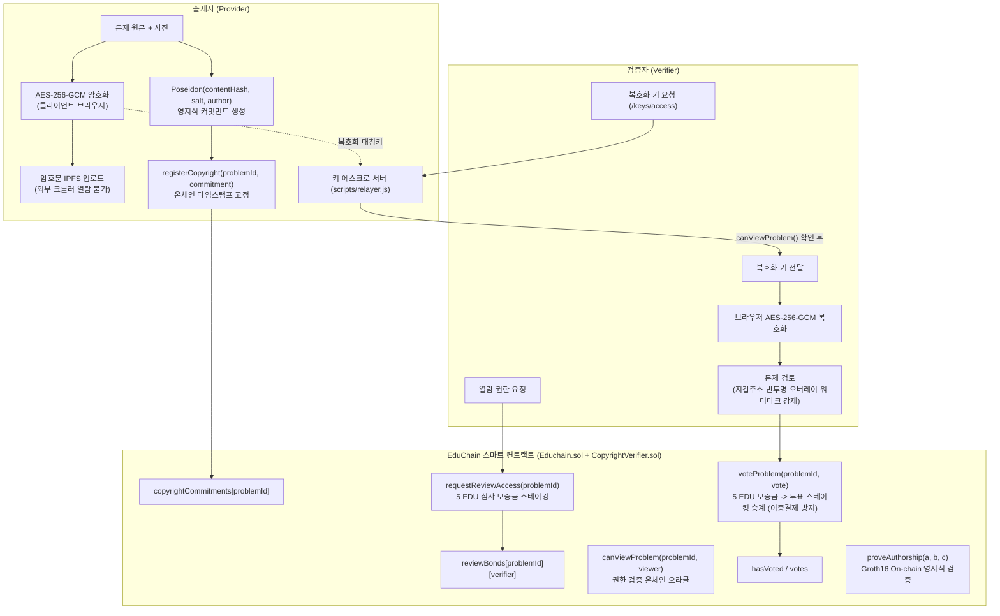

# 이더리움 ERC-20 기반 교내 학습 문제 공유·검증 마켓플레이스 및 탈중앙화 보상 시스템(EduChain) 연구 보고서

---

## 제1장. 서론 (Introduction)

### 1.1 연구 배경 및 목적

현재 대학가에서 폭넓게 활용되는 온라인 커뮤니티(에브리타임 족보 게시판 등)와 상용 자료 공유 플랫폼(해피캠퍼스, Chegg 등)은 학업 보조 수단으로서 높은 수요를 보이고 있으나, 구조적으로 두 가지 심각한 한계를 지니고 있다. 첫째, 업로드된 학습 문제와 해설 콘텐츠에 대한 사전적·객관적 검증 절차가 부재하여 오답이나 오류가 포함된 자료가 그대로 유통되는 신뢰성 부족 문제이다. 학습자는 자료를 유료로 결제하거나 포인트를 차감한 뒤에야 비로소 내용의 부실함이나 오류를 인지하게 되는 정보 비대칭(Information Asymmetry) 상황에 놓여 있다. 둘째, 양질의 문제를 직접 제작하거나 정교한 해설을 작성한 기여자, 그리고 기존 문제의 오류를 찾아내어 교정한 검증자에게 합당한 경제적 가치가 환원되지 않는 불분명한 보상 체계의 한계이다. 기존 중앙집중형 플랫폼에서는 활동 보상으로 지급되는 포인트가 플랫폼 외부에서 실질적 교환 가치를 갖지 못하거나, 판매 수익의 대부분을 플랫폼 운영사가 중개 수수료 명목으로 수취하여 핵심 기여자의 지속적인 참여 유인이 급격히 저하된다.

본 연구 프로젝트는 블록체인의 불변성(Immutability)과 투명성(Transparency)을 바탕으로, 대학 구성원이 직접 학습 문제를 출제(Provider)하고 다수의 동료 구성원이 이를 교차 검증(Verifier)하며, 통계적으로 신뢰도가 입증된 콘텐츠를 학습자(Buyer)가 합리적인 가격에 구매하여 그 수익이 기여도에 따라 이더리움 ERC-20 표준 토큰(EduToken, 이하 EDU)으로 자동 정산되는 탈중앙화 교육 생태계 EduChain을 설계하고 구현하는 것을 목적으로 한다.

특히 2026년 4월 17일 프로젝트 타당성 검토 논의에서 도출된 바와 같이, 본 플랫폼이 기존 유사 플랫폼과 차별화되어 학생들이 실질적으로 사용할 수밖에 없는 핵심 가치는 두 가지로 요약된다. 하나는 스테이킹(Staking)과 슬래싱(Slashing), 그리고 통계적 일치도 지표인 Fleiss Kappa 알고리즘이 결합된 다중 검증 시스템을 통해 오답 위험이 제거된 고신뢰 학습 문제만을 선별하여 제공한다는 점이다. 다른 하나는 중앙 중개 기관의 과도한 마진을 제거하고 스마트 컨트랙트 자동 정산을 도입함으로써, 학생들에게 부담 없는 합리적인 열람 가격(기본 10 EDU)을 책정하면서도 출제자에게 판매 수익의 70%, 검증자 그룹에게 20%를 즉각 환원하는 고효율 보상 구조를 실현했다는 점이다.

### 1.1.1 핵심 이론 및 설계 방법론

본 시스템의 아키텍처와 경제 모델은 다음 네 가지 학술적 이론 및 공학적 방법론을 결합하여 설계되었다.

1. **Proof of Brain (PoB, 두뇌 증명 메커니즘):**
   단순한 화폐 자본의 예치 규모에 비례하여 네트워크 보상과 의사결정권을 독점하는 지분증명(Proof of Stake, PoS)이나 연산 자원을 소모하는 작업증명(Proof of Work, PoW)과 달리, 인간의 인지적 노력(학습 문제 출제, 논리적 해설 작성, 정답 유무 및 오류 검증)을 측정하여 보상하는 메커니즘이다. 자본 규모가 아닌 콘텐츠의 질적 가치와 검증 정확도에 따라 토큰을 분배하는 지능형 마이닝(Intelligent Mining) 개념으로 활용되며, 대학 교육 생태계에서 지식 생산자와 검증자의 지적 노동을 정량적 가치로 치환하는 핵심 원리로 작동한다.

2. **Token Economy Design Method (TEDM, 토큰 이코노미 설계 방법론):**
   블록체인 생태계 설계 시 인센티브(Incentive), 거버넌스(Governance), 토큰코믹스(Tokenomics)라는 세 가지 기둥을 체계적으로 수립하는 방법론이다. 본 연구에서는 TEDM 절차에 따라 (1) 출제자·검증자·구매자·플랫폼 운영자라는 4대 이해관계자를 식별하고, (2) 각 참여자에게 요구되는 바람직한 행동(고품질 문제 출제, 정직한 검증 투표, 정당한 대가 지불)과 억제해야 할 악의적 행동(오류 문제 업로드, 무작위 투표, 어뷰징)을 정의한 뒤, (3) 이를 강제하기 위한 스테이킹·슬래싱 수치와 70:20:10 수익 분배 비율, 그리고 비인플레이션 기반의 토큰 순환 구조를 수립하였다.

3. **게임 이론 (Game Theory) 및 내쉬 균형 (Nash Equilibrium):**
   검증자가 문제를 성실히 풀고 정답 여부를 정직하게 투표하는 전략이 무임승차(내용을 보지 않고 무작위로 찍는 행위)나 악의적 담합보다 항상 높은 기대보수(Expected Payoff)를 갖도록 보상 및 페널티 수치를 설계하는 데 사용된다. 모든 참여자가 자신의 이익을 극대화하기 위해 선택하는 최적 전략의 조합이 곧 정직한 출제와 정직한 검증이 되도록 내쉬 균형을 수학적으로 유도하였다.

4. **크라우드소싱 검증 체계 (Crowdsourced Verification System):**
   소수의 중앙 관리자가 모든 과목의 문제를 일일이 검수할 때 발생하는 병목 현상과 비용 문제를 해결하기 위해, 다수의 독립적인 학내 사용자가 온체인 이벤트 기반 투표를 통해 데이터의 진위 여부와 품질을 가려내는 집단지성(Collective Intelligence) 모델이다. 여기에 검증자 개인의 누적 정확도를 반영하는 평판 가중치(Reputation Weight)와 다수 평가자 간 일치도를 측정하는 Fleiss Kappa 통계 모델을 결합하여 집단지성의 신뢰성을 정량적으로 보증한다.

### 1.2 핵심 과제

본 연구가 해결하고자 하는 세 가지 핵심 기술 및 경제적 과제는 다음과 같다.

* **ERC-20 표준 및 확장 프로토콜 활용:** 이더리움 ERC-20 표준을 기반으로 하되, 사용자 경험(UX) 향상을 위해 오프체인 서명 기반 권한 승인 규격인 EIP-2612(Permit)와 가스비 대납 메타트랜잭션 규격인 ERC-2771(계정 추상화 EIP-7702 지향 구조)을 결합한 스마트 컨트랙트 토큰 이코노미를 구축한다.
* **가스 효율적인 보상 및 투표 시스템 구현:** 투표 단계에서는 온체인 스토리지 기록 대신 이벤트(Event) 로그를 활용하여 가스비를 절감하고, 신뢰도가 확정된 이후에만 최종 검증자 명단을 블록체인 상태에 기록하며, 보상 분배 단계에서는 참여자 수 증가에 따른 가스비 폭발을 막기 위해 Pull 방식의 $O(1)$ 복잡도 보상 청구 알고리즘을 구현한다.
* **생태계 지속 가능성 및 법적 준거성 확보:** 단순 토큰 추가 발행(Minting)에 의존하는 인플레이션 구조를 배제하고 실제 구매자의 결제 토큰을 분배하는 실수요 기반 경제 모델을 확립하며, 대학 재정 지원금·학내 복지 바우처·단일 오프램프(Off-ramp) 연동과 함께 국내 금융위원회의 토큰증권(STO) 가이드라인 및 대한민국 저작권법 제102조(온라인서비스제공자의 책임 제한)를 완벽히 준수하는 법적·기술적 보호 장치를 수립한다.

---

## 제2장. 시스템 모델 및 참여자 역할 (System Model & Stakeholder Roles)

### 2.1 참여자 구조 및 인센티브·리스크 매트릭스

EduChain 시스템은 인간의 지적 노력을 측정하여 보상하는 Proof of Brain(PoB) 메커니즘을 기반으로 출제자(Provider), 검증자(Verifier), 구매자(Buyer), 그리고 생태계 운영 금고(Treasury 및 Platform Reserve)가 상호작용하는 순환형 마켓플레이스로 설계되었다.

| 참여자 구분 | 핵심 역할 (Role) | 경제적·비경제적 인센티브 (Incentive) | 리스크 및 페널티 (Penalty / Slashing) |
| :--- | :--- | :--- | :--- |
| **출제자 (Provider)** | 고품질 학습 문제, 풀이 해설 및 시각 자료(이미지·PDF) 업로드 (출제 시 100 EDU 스테이킹 필수) | 검증 통과 시 예치금 100 EDU 전액 환급, 문제 판매 발생 시마다 결제 수익의 70% 지속 수령, 출제자 평판 상승 | 저품질·오류·저작권 침해 문제 업로드로 기각(Rejected) 판정 시 스테이킹 자산 100 EDU 전액 슬래싱(Treasury 몰수) |
| **검증자 (Verifier)** | 출제된 문제의 정답 유무, 해설 정확성 및 오류 여부 검증 투표 (투표 시 5 EDU 스테이킹 필수) | 검증 통과 시 원금 5 EDU 환급, 문제 판매 수익의 20%를 개인별 평판 가중치(0.50x~2.00x) 비율로 반복 분배 수령, 수석·우수 검증자 SBT 배지 획득 | 악의적 투표 또는 다수 합의와 배치되는 오답 투표 시 예치금 5 EDU 전액 몰수(Treasury 귀속), 누적 오답 증가에 따른 평판 가중치 삭감으로 추후 검증 보상 축소 |
| **구매자 (Buyer)** | 학업에 필요한 검증 완료(Verified) 학습 콘텐츠 구매 및 열람 | 통계적·집단지성 검증을 거친 고품질 무오류 학습 데이터 확보, 기존 상용 플랫폼 대비 합리적인 가격으로 열람 | 문제 열람권 구매를 위한 토큰 지출 (기본 10 EDU) |
| **플랫폼 금고 (Treasury & Reserve)** | 생태계 유동성 유지, 가스리스 릴레이어(Paymaster) 비용 충당 및 부정행위 몰수 자산 관리 | 문제 판매 수익의 10%(`platformReserve`) 자동 적립 및 슬래싱 몰수금(`treasury`) 귀속 | 누적 풀이 임계 규모 초과 시 토큰 가치 방어를 위한 일부 물량 영구 소각(Burn) 또는 유동성 풀 재투입 의무 |

### 2.2 검증자의 필요성과 초기 스테이킹 참여 유인에 대한 게임 이론적 분석

시스템 설계 과정에서 제기된 핵심 질문 중 하나는 검증자가 왜 필요하며, 검증자의 투표를 어떻게 신뢰할 수 있고, 특히 생태계 초기에 검증자가 자신의 토큰을 위험에 노출하면서까지 예치(Staking)에 참여할 메리트가 있는가라는 점이다. 본 프로젝트는 이를 다음 세 가지 경제적·수학적 설계로 해결하였다.

#### 1) 스테이킹 대비 누적 기대보상의 비대칭적 우위 설계 (소액 예치·다회 배당 구조)
검증자가 초기에 예치할 메리트가 부족해지는 현상은 예치금(Stake) 규모가 기대 보상(Expected Reward)보다 지나치게 클 때 발생한다. 이를 해결하기 위해 EduChain 스마트 컨트랙트(`contracts/Educhain.sol`)는 출제자의 예치금을 `PROVIDER_STAKE = 100 EDU`로 높게 설정하여 불량 문제 유입을 차단하는 반면, 검증자의 예치금은 20분의 1 수준인 `VERIFIER_STAKE = 5 EDU`로 낮게 책정하였다.

더욱 중요한 구조적 핵심은 검증 보상이 1회성 지급으로 끝나지 않는다는 점이다. 컨트랙트는 문제가 검증을 통과(`status == 1`)하는 시점에 올바른 투표를 수행한 검증자 배열을 `correctVerifiersOf[_problemId]` 매핑에 영구 저장한다. 이후 해당 문제를 다수의 학생(Buyer)이 구매(`purchaseProblem`)할 때마다 결제 금액(예: 10 EDU)의 20%(2 EDU)가 매번 정산되어 해당 검증자들에게 반복적으로 누적된다.

구체적인 수치로 계산해 보자. 한 문제의 가격이 $P = 10\text{ EDU}$이고, 한 학기 동안 해당 과목을 수강하는 학생 중 $M = 30$명이 이 문제를 구매하며, 정답 검증에 참여한 검증자가 $k = 2$명(동일 평판 가중치 가정)이라고 하자. 검증자 1인이 예치하는 금액은 $S_v = 5\text{ EDU}$이며, 검증 확정 즉시 원금 $5\text{ EDU}$를 돌려받는다. 이후 30명의 학생이 문제를 구매함에 따라 검증자 1인이 수령하는 순수익 $R_v$는 다음과 같다.

$$R_v = M \times \frac{0.20 \times P}{k} = 30 \times \frac{2\text{ EDU}}{2} = 30\text{ EDU}$$

즉, 검증자는 단 $5\text{ EDU}$를 일시 예치하고 원금을 전액 환급받는 동시에, 학기 중 누적 판매를 통해 원금의 600%에 달하는 $30\text{ EDU}$의 순보상을 획득한다. 설령 단 5명의 학생만 문제를 구매하더라도 검증자 1인당 $5\text{ EDU}$의 순수익(원금 대비 100% 수익률)이 발생한다. 따라서 요구되는 스테이킹(5 EDU)이 누적 기대 보상보다 현저히 작도록 설계되어 있으므로 검증자의 초기 참여 메리트가 확고하게 성립한다.

#### 2) 초기 부트스트래핑(Bootstrapping) 지원
생태계 출범 직후 토큰을 전혀 보유하지 않은 신규 학생이라도 즉시 검증자로 참여할 수 있도록, 학내 인증을 마친 초기 사용자에게 시드 토큰을 공급하는 Faucet 메커니즘(100 EDU 지급, 상용 환경에서는 대학 LINC+ 및 교육혁신지원사업 기금 기반의 초기 학습 바우처)을 제공한다. 따라서 사용자는 현금 지출 없이 부여받은 초기 시드 토큰 중 5 EDU를 활용해 검증에 참여하고, 정직한 검증을 통해 보상을 불려 나갈 수 있다.

#### 3) 정직한 투표가 내쉬 균형(Nash Equilibrium)이 되는 조건 증명
검증자 $i$가 문제의 정오답을 성실히 검토하여 올바른 판단을 내릴 확률을 $p \in (0.5, 1]$이라 하고, 문제를 풀지 않고 무작위로 찍을 때 정답과 일치할 확률을 $0.5$라고 하자. 검증자의 예치금을 $S_v = 5$, 기대 누적 보상 지분을 $V$, 슬래싱 시 평판 가중치 하락에 따른 미래 기대 수익 손실분을 $L_{rep}$라 할 때, 성실 검증 시의 인지적 노력 비용 $C_{effort}$를 고려한 기대효용 $E[U_{honest}]$와 무작위 투표 시의 기대효용 $E[U_{random}]$은 다음과 같다.

$$E[U_{honest}] = p \cdot V - (1 - p) \cdot (S_v + L_{rep}) - C_{effort}$$

$$E[U_{random}] = 0.5 \cdot V - 0.5 \cdot (S_v + L_{rep})$$

성실한 검증이 무작위 투표를 지배(Strict Dominance)하기 위한 조건 $E[U_{honest}] > E[U_{random}]$을 정리하면 다음과 같다.

$$(p - 0.5) \cdot (V + S_v + L_{rep}) > C_{effort}$$

EduChain에서는 예치금 몰수($S_v = 5\text{ EDU}$)뿐만 아니라, 오답 3회 누적 시마다 향후 모든 검증 보상의 가중치를 $0.10\text{x}$씩 삭감하는 누적 평판 페널티($L_{rep}$)와 다회 판매 보상($V$)이 결합되어 좌변의 $(V + S_v + L_{rep})$ 값이 인지적 비용 $C_{effort}$를 크게 상회한다. 특히 무작위로 투표할 경우($p = 0.5$), 단일 구매 단계 기준 기대수익이 $0.5 \times 1 - 0.5 \times 5 = -2.0\text{ EDU} < 0$으로 즉시 음수가 되므로, 보상만 노리고 대충 투표하는 행위는 경제적으로 반드시 손실을 보게 되며 정직한 검증만이 유일한 내쉬 균형 전략이 된다.

### 2.3 유사 플랫폼 대비 차별성 및 실질적 서비스 효용 (2026.04.17 논의 반영)

학생들이 기존 에브리타임 족보 게시판이나 해피캠퍼스, Chegg 대신 EduChain을 실질적으로 사용해야 하는 이유는 다음 표와 같이 명확한 구조적 우위에 기반한다.

| 비교 항목 | 대학 익명 커뮤니티 (에브리타임 등) | 기존 중앙화 자료 사이트 (해피캠퍼스·Chegg) | 탈중앙화 교육 생태계 (EduChain) |
| :--- | :--- | :--- | :--- |
| **문제 및 해설의 신뢰성** | 검증 절차 전무 (오답·잘못된 풀이 다수 존재) | 업로더 개인 작성 또는 비공개 검수로 오류 판별 곤란 | **다수 검증자의 스테이킹 투표 + Fleiss Kappa($\kappa$) 통계 검증 통과 자료만 유통** |
| **열람 가격 합리성** | 포인트제 운영 (현금화 불가, 폐쇄적 소비) | 월 고액 구독료(Chegg 약 2만~3만 원) 또는 건별 과금 | **중개 마진 최소화를 통한 합리적 정가 책정 (문제당 10 EDU)** |
| **기여자 수익 배분율** | 금전적 보상 없음 (단순 커뮤니티 포인트) | 플랫폼이 30%~50% 이상 수수료 수취, 검증자 보상 없음 | **출제자 70%, 검증자 20% 자동 정산 (플랫폼 운영 재고 10%만 최소 유지)** |
| **보상 투명성 및 환금성** | 불투명, 외부 환전 불가 | 정산 주기 지연 및 최소 출금 한도 제약 | **스마트 컨트랙트 즉시 정산, DEX·Off-ramp·교내 복지 바우처 연동** |

---

## 제3장. 보상 및 데이터 처리 시스템의 기술적 설계 (Technical Architecture)

### 3.1 O(1) 복잡도 기반 보상 분배 알고리즘 및 비인플레이션 정산

수천 명의 생태계 참여자에게 보상이 발생할 때마다 컨트랙트가 배열을 순회하며 직접 토큰을 전송(Push)하는 방식은 참여자 수 $n$에 비례하여 가스비가 선형 증가하는 $O(n)$ 복잡도 문제를 야기한다. 이더리움 가상머신(EVM) 환경에서 루프 내 상태 변경(`SSTORE`, 슬롯당 최대 20,000 gas)이 반복되면 트랜잭션 가스 소모량이 블록 가스 한도(Block Gas Limit, 약 3,000만 gas)를 초과하여 컨트랙트 전체가 멈추는 서비스 거부(DoS) 상태에 빠질 수 있다.

이를 해결하기 위해 본 시스템은 Synthetix 프로토콜의 게으른 보상 계산(Lazy Reward Calculation) 모델과 Pull 방식의 청구(Claim) 아키텍처를 결합하여 설계하였다.

#### 1) 수학적 모델링
특정 기간(Epoch) 또는 거래 이벤트 동안 발생한 총 보상액 변화량 $\Delta R$을 전체 기여도(가중치) 합 $S_{total}$로 나누어 전역 누적 변수 $R_t$를 단 1회 업데이트한다.

$$R_t = R_{t-1} + \frac{\Delta R}{S_{total}}$$

이후 개별 사용자가 보상을 직접 청구(Claim)하는 시점에만 자신이 진입했을 때의 누적 변수 스냅샷 $R_{user\_entry}$와 현재 전역 변수 $R_{now}$의 차이에 자신의 기여 가중치 $s_{user}$를 곱하여 보상을 산출한다.

$$\text{Reward}_{user} = s_{user} \times (R_{now} - R_{user\_entry})$$

#### 2) 스마트 컨트랙트 실결제 정산 및 Pull 모델 구현 (`contracts/Educhain.sol`)
초기 프로토타입에서는 검증 확정(`finalizeProblem`) 시점에 아직 구매자가 존재하지 않음에도 임의로 토큰을 신규 발행(`_mint`)하여 보상을 지급하는 구조적 한계가 존재하였다. 이를 2026년 9월 16일 아키텍처 개편을 통해 완전히 재설계하여, **실제 구매자(학생)의 결제 대금에 기반한 비인플레이션 70:20:10 정산 및 $O(1)$ Pull 청구 구조**로 완성하였다.

* **실결제 기반 70:20:10 배분 (`purchaseProblem`):** 검증이 완료(`status == 1`)된 문제를 학습자가 구매하면, 학습자의 지갑에서 컨트랙트로 문제 가격(`p.price`)만큼 실제 EDU 토큰이 이체(`_transfer(sender, address(this), p.price)`)된다. 컨트랙트는 이 결제 대금을 즉시 출제자 몫 70%(`providerCut`), 정답 검증자 풀 20%(`verifierCut`), 플랫폼 운영 재고 10%(`platformCut = p.price - providerCut - verifierCut`, 정수 나눗셈 반올림 오차까지 100% 흡수)로 분할하여 각 참여자의 `claimableRewards[address]` 매핑에 누적한다. 이때 검증자 풀 20%는 해당 문제의 정답 검증자들(`correctVerifiersOf[_problemId]`)에게 각자의 평판 가중치(`getReputationWeight`) 비율에 따라 정밀 배분된다.
* **$O(1)$ 상수 시간 보상 청구 (`claimReward`):** 개별 출제자와 검증자는 자신이 원하는 시점에 `claimReward()` 함수를 호출하여 누적된 보상을 인출(Pull)한다. 이 함수는 오직 호출자 본인의 `claimableRewards[sender]` 슬롯 1개만 0으로 초기화한 뒤 컨트랙트가 보유한 실제 토큰 잔고에서 `_transfer(address(this), sender, reward)`를 수행한다. 따라서 전체 시스템의 총 참여자 수가 수천 명이나 수만 명으로 늘어나더라도, 개별 사용자의 보상 청구 트랜잭션 복잡도는 완벽한 $O(1)$로 고정되며 실측 가스 소모량 역시 약 54,000~78,000 gas 이내로 일정하게 유지된다.

### 3.2 이벤트(Event) 기반 투표 아키텍처와 The Graph 데이터 검색 최적화

#### 1) 온체인 스토리지 배제 및 이벤트 기반 투표 후 신뢰도 확정 구조
블록체인에서 가장 비용이 많이 드는 연산은 영구 스토리지(`storage`)에 구조체나 동적 배열을 기록하는 `SSTORE` 연산이다. 만약 모든 검증자의 투표 내역(투표자 주소, 문제 번호, 찬반 여부)을 컨트랙트 내부의 구조체 배열에 일일이 저장한다면 투표 시마다 막대한 가스비가 발생한다.

이를 해결하기 위해 EduChain은 **투표 단계에서는 스토리지 배열 저장을 배제하고 이벤트(Event)만 발생시킨 뒤, 오프체인에서 신뢰도(Fleiss Kappa)가 확정된 이후에만 최종 검증 결과를 블록체인 스토리지에 올리는 2단계 확정 아키텍처**를 채택하였다.

1. **투표 단계 (`voteProblem`):** 검증자가 투표할 때 컨트랙트는 중복 투표 방지용 불리언 매핑(`hasVoted[_problemId][sender] = true`)과 스테이킹 합계만 갱신하고, 실제 투표 데이터는 `emit Voted(_problemId, sender, _isCorrect)` 이벤트 로그로만 브로드캐스트한다. EVM에서 이벤트 로그는 스토리지가 아닌 트랜잭션 영수증 로그 영역(`LOG3` 옵코드)에 기록되므로 가스 소모량이 스토리지 저장 방식 대비 절반 이하(실측 84,383 gas)로 절감된다.
2. **신뢰도 산출 및 최종 블록체인 기록 단계 (`finalizeProblem`):** 외부 인덱서(The Graph)와 프론트엔드가 `Voted` 이벤트 로그들을 수집하여 Fleiss Kappa($\kappa$) 신뢰도 점수를 실시간 계산한다. 신뢰도가 검증 기준을 충족하여 확정(`finalizeProblem`)될 때 비로소 정답 검증자 주소 목록이 온체인 스토리지(`correctVerifiersOf[_problemId]`)에 기록되고 문제 상태(`status`)가 확정된다.

#### 2) The Graph 서브그래프(Subgraph) 설계 및 폴백(Fallback) 이중화
블록체인 노드에 직접 전체 블록의 이벤트를 매번 스캔하는 방식은 문제 수가 증가할수록 프론트엔드 로딩 속도를 저하시킨다. 이를 해결하기 위해 The Graph 프로토콜의 서브그래프를 구축하였다.

* **스키마 정의 (`subgraph/schema.graphql`):** `Problem` 엔티티(`id`, `provider`, `ipfsCid`, `status`, `subject`, `authorName`, `title`, `content`)와 `Vote` 엔티티(`id`, `problemId`, `verifier`, `isCorrect`)를 정의하였다. 특히 스마트 컨트랙트 스토리지에는 가스 절감을 위해 32바이트 `ipfsCid`만 저장하고 과목명(`subject`)과 작성자명(`authorName`)은 `ProblemSubmitted` 이벤트 파라미터로만 방출(emit)하되, 서브그래프 매핑 핸들러(`subgraph/src/edu-chain.ts`)가 이를 가로채어 인덱싱함으로써 온체인 가스비 절감과 프론트엔드 고속 검색(과목별·작성자별 필터링)을 동시에 달성하였다.
* **고가용성 폴백(Fallback) 설계 (`src/App.jsx`):** 만약 로컬이나 원격 Graph Node가 일시적으로 응답하지 않더라도 서비스가 중단되지 않도록, `loadProblems()` 함수 내부에 이중화 복구 로직을 구현하였다. 서브그래프 쿼리 실패 시 즉시 컨트랙트의 `problems(i)` 상태와 `contract.queryFilter(contract.filters.Voted(), 0, latest)` 온체인 이벤트 필터링을 결합하여 문제 목록과 투표 데이터를 100% 동일하게 복원한다.

### 3.3 IPFS 기반 스토리지 관리 및 이미지·문서 업로드 파이프라인

#### 1) 32바이트 멀티해시 압축 저장을 통한 가스비 절감
문제 본문 텍스트와 고해상도 이미지, PDF 등 대용량 데이터를 이더리움 온체인에 직접 저장하면 메가바이트당 수천만 원 이상의 가스비가 발생한다. 따라서 모든 원본 콘텐츠는 분산형 파일 시스템인 IPFS(InterPlanetary File System)에 저장하고, 스마트 컨트랙트에는 데이터의 무결성을 가리키는 식별자(CID)만 기록한다.

이때 일반적인 IPFS CIDv0 문자열(예: `Qm...`으로 시작하는 46글자 Base58 문자열)을 Solidity의 `string` 타입으로 그대로 저장하면 동적 길이 메타데이터로 인해 최소 2개 이상의 32바이트 스토리지 슬롯을 점유하게 된다. 본 프로젝트(`src/utils/ipfs.js`)는 CIDv0가 내부적으로 2바이트 해시 함수 헤더(`0x12` = SHA-256, `0x20` = 32바이트 길이)와 32바이트 실제 해시 다이제스트의 결합(총 34바이트 멀티해시)이라는 점에 착안하여, `cidToBytes32()` 함수를 통해 앞의 2바이트 고정 헤더(`0x1220`)를 제거한 뒤 정확히 32바이트(`bytes32`) 단일 슬롯에 압축 저장하고, 조회 시 `bytes32ToCid()`로 다시 `0x1220` 헤더를 붙여 Base58 CID로 무손실 복원하는 최적화 기법을 구현하였다.

#### 2) 문제 파일이 사진(이미지)으로 업로드되었을 때의 IPFS 처리 메커니즘
사용자가 텍스트 입력 대신 수학 수식이나 도형이 포함된 문제 사진(이미지 파일)을 첨부하여 업로드할 때도 해당 사진 파일은 IPFS 네트워크에 직접 업로드되어 영구 보존된다. 구체적인 2단계 이중 피닝(Dual-Pinning) 처리 흐름은 다음과 같다.

1. **1단계 — 이미지 바이너리의 IPFS 업로드 (`uploadFileToPinata`):**
   사용자가 출제 폼(`src/App.jsx`)에서 사진 파일을 선택하면, 프론트엔드는 먼저 `src/utils/ipfs.js`의 `uploadFileToPinata(file)` 함수를 호출한다. 이 함수는 브라우저의 `FormData` 객체에 이미지 바이너리 파일과 메타데이터, 그리고 `cidVersion: 0` 옵션을 담아 Pinata의 파일 전용 엔드포인트(`https://api.pinata.cloud/pinning/pinFileToIPFS`)로 전송한다. 업로드가 완료되면 IPFS 네트워크 상에 해당 사진 파일 자체가 저장되고, 그 사진을 가리키는 고유 이미지 해시(`imageCid`, 예: `bafybeibhrh44q7k4sqof3svehl4pvgqxdt4pu56gp7tbru4ijebw6ws37u`)가 반환된다.
2. **2단계 — 문제 메타데이터와 이미지 CID의 JSON 결합 및 IPFS 업로드 (`uploadToIPFS`):**
   획득한 `imageCid`는 과목명(`subject`), 출제자(`author`), 문제 제목(`title`), 텍스트 설명(`content`)과 함께 하나의 구조화된 JSON 객체로 묶인다. 이후 `uploadToIPFS()` 함수가 Pinata의 JSON 엔드포인트(`https://api.pinata.cloud/pinning/pinJSONToIPFS`)를 호출하여 이 메타데이터 JSON 자체를 다시 IPFS에 업로드하고, 최종 문제 패키지 CID를 반환받는다.
3. **3단계 — 온체인 해시 등록 및 전용 게이트웨이 렌더링:**
   최종 문제 패키지 CID만 32바이트 `bytes32`로 변환되어 스마트 컨트랙트의 `submitProblem()`에 기록된다. 이후 학습자나 검증자가 문제를 조회할 때는 컨트랙트에서 `bytes32`를 읽어 JSON을 먼저 패치한 뒤, JSON 내부의 `imageCid`를 전용 Pinata 게이트웨이(예: 테스트 및 검증에 사용된 실제 이미지 링크 `https://emerald-magnetic-fish-225.mypinata.cloud/ipfs/bafybeibhrh44q7k4sqof3svehl4pvgqxdt4pu56gp7tbru4ijebw6ws37u`)를 통해 화면에 즉시 렌더링한다.

### 3.4 상용 전제하에 The Graph와 IPFS를 로컬 및 하이브리드 환경에서 테스트하는 이유 (2026.05.09 업데이트 반영)

본 프로젝트는 상용 배포를 전제로 설계되었음에도 불구하고, 개발 및 통합 검증 과정에서 Docker 기반의 로컬 The Graph 스택(`graph-node`, `ipfs/kubo`, `postgres`)과 로컬 IPFS 폴백 환경을 병행 구축하여 테스트를 수행하였다. 상용 전제하에서 이러한 로컬 및 하이브리드 테스트 아키텍처를 채택한 데에는 세 가지 명확한 공학적·경제적 이유가 존재한다.

1. **상용 인프라 과금 및 비용 발생 이슈 통제:**
   Pinata 등 상용 IPFS 피닝 서비스(프로젝트 연동 Pinata API Key 식별자: `e4a226256ff868b4b951`)는 무료 티어 초과 시 고정 저장 용량(Pinning Storage), 전용 게이트웨이 대역폭(Bandwidth), 월간 요청(Request) 횟수에 비례하여 비용이 발생한다. 마찬가지로 The Graph의 상용 탈중앙화 네트워크(The Graph Network)에 서브그래프를 배포하고 쿼리를 수행하려면 인덱서(Indexer) 보상을 위한 GRT 토큰 시그널링(Signaling) 예치금과 쿼리당 과금 수수료가 지출된다. 캡스톤 개발 기간 동안 수백 회에 달하는 문제 등록, 사진 파일 업로드, 스마트 컨트랙트 재배포 및 서브그래프 스키마 수정 테스트를 매번 상용 유료 네트워크에서만 수행할 경우 불필요한 클라우드 및 토큰 비용이 누적된다. 따라서 일상적인 반복 검증은 로컬 컨테이너와 폴백 환경에서 비용 0원으로 수행하고, 마일스톤 검증 시점에 실제 Pinata 게이트웨이(`emerald-magnetic-fish-225.mypinata.cloud`)와 L2 테스트넷(Base Sepolia)을 연동하는 비용 최적화 전략을 취하였다.

2. **로컬 블록체인(Hardhat Node) 초기화와의 인덱싱 상태 동기화:**
   스마트 컨트랙트의 슬래싱 조건이나 평판 가중치 수식을 디버깅할 때는 로컬 Hardhat 네트워크(`Chain ID: 31337`)를 수시로 재시작하게 되며, 이때 체인의 블록 번호가 0번(Genesis Block)으로 리셋된다. 외부 클라우드 인덱서는 로컬 PC 내부의 `127.0.0.1:8545` 노드에 직접 접근할 수 없을뿐더러, 체인이 리셋될 때 기존에 인덱싱된 블록 높이와 충돌을 일으킨다. 반면 로컬 Docker로 구동되는 Graph Node는 `docker compose down -v` 명령을 통해 Postgres DB와 IPFS 볼륨을 즉시 초기화하고 블록 0번부터 이벤트 인덱싱 정합성을 결정론적(Deterministic)으로 재검증할 수 있다.

3. **네트워크 단절 상황에서의 개발 연속성 및 무중단 상용 전환 보장:**
   `src/utils/ipfs.js`와 `src/App.jsx`는 환경변수(`VITE_PINATA_JWT`, `VITE_PINATA_GATEWAY`)와 로컬 Graph Node 연결 상태에 따라 실제 상용 API와 로컬 Mock·컨트랙트 직독 모드를 자동으로 오가는 하이브리드 어댑터 패턴으로 구현되었다. 스마트 컨트랙트의 데이터 규격(`bytes32` CID 및 이벤트 시그니처)은 로컬과 상용 환경이 100% 동일하므로, 컨트랙트 코드를 단 한 줄도 수정하지 않고 엔드포인트 설정만으로 상용 전환이 완료된다.

---

## 제4장. 고급 게임화 및 품질 관리 메커니즘 (Gamification & Quality Control)

### 4.1 평판 가중치 시스템, NFT 배지 및 소울바운드 토큰 (SBT)

단순한 단기 토큰 보상만으로는 검증자의 지속적인 학술적 성실성을 담보하기 어렵다. 이에 따라 EduChain은 온체인 누적 평판 가중치 알고리즘과 비금전적 명예 인센티브인 NFT 배지 및 소울바운드 토큰(Soulbound Token, SBT)을 결합하였다.

#### 1) 온체인 누적 평판 가중치 (`getReputationWeight`)
스마트 컨트랙트(`contracts/Educhain.sol`)는 모든 검증자의 누적 정답 투표 횟수(`correctVoteCount[verifier]`)와 누적 오답 투표 횟수(`wrongVoteCount[verifier]`)를 영구적으로 기록하며, 이 값은 초기화되지 않는다. 검증자의 현재 보상 가중치 $W(v)$는 기본값 $1.00\text{x}$(정수 스케일 100)에서 출발하여 다음 공식에 의해 산출된다.

$$W(v) = \text{clamp}\left(1.00 + 0.10 \times \left\lfloor \frac{C_{correct}(v)}{10} \right\rfloor - 0.10 \times \left\lfloor \frac{C_{wrong}(v)}{3} \right\rfloor, \; 0.50, \; 2.00\right)$$

* **비대칭적 보상·처벌 주기:** 가중치 $0.10\text{x}$를 높이기 위해서는 올바른 검증을 10회 누적해야 하지만, 오답 투표는 단 3회만 누적되어도 가중치가 $0.10\text{x}$ 즉시 삭감된다. 예를 들어 정답을 50회 누적하여 $1.50\text{x}$ 가중치를 달성한 베테랑 검증자라도 이후 오답을 6회 기록하면 페널티 $-0.20\text{x}$가 반영되어 가중치가 $1.30\text{x}$로 하락한다.
* **상·하한 캡(Cap) 설정의 경제적 근거:** 가중치의 하한을 $0.50\text{x}$, 상한을 $2.00\text{x}$로 제한한 이유는 초기 소수 베테랑 검증자가 보상의 대부분을 영구 독점하여 신규 검증자의 진입 유인을 떨어뜨리는 부익부 빈익빈 현상을 막기 위함이다. 신규 진입자도 최소 $1.00\text{x}$의 기본 몫을 보장받으면서, 꾸준히 성실하게 검증한 상위 검증자는 동일 문제 검증 시 최대 2배의 보상 배율을 적용받아 장기 참여 동기를 유지한다.

#### 2) 검증자 NFT 배지 및 소울바운드 토큰 (SBT)
검증 횟수와 평판 가중치가 일정 기준에 도달한 사용자에게는 학업 성취도와 검증 전문성을 증명하는 비금전적 인센티브를 부여한다.
* **검증자 등급 배지 (NFT):** 평판 가중치가 $1.10\text{x}$ 이상인 사용자에게는 우수 검증자(Senior Verifier), $1.50\text{x}$ 이상인 사용자에게는 수석 검증자(Chief Verifier) 칭호와 함께 온체인 배지를 수여하여 학내 TA(교육조교) 선발이나 취업 포트폴리오에서 직무 역량 증빙 자료로 활용할 수 있게 한다.
* **소울바운드 토큰 (SBT):** 해당 평판과 학업 검증 이력 배지는 타인에게 매매하거나 양도할 수 없는 소울바운드 토큰(EIP-5192 규격 기반 지갑 귀속형 토큰)으로 설계하여, 금전으로 학업 평판을 사고파는 행위를 원천 차단하고 실제 학습 기여 이력을 온체인에 영구 기록한다.

### 4.2 Fleiss Kappa ($\kappa$) 기반 검증 품질 측정 모델

다수의 독립적인 검증자가 특정 문제에 대해 내린 판정(정상 vs 오류)이 단순한 우연의 일치가 아니라 통계적으로 유의미한 합의에 도달했는지를 측정하기 위해 범주형 데이터 일치도 통계 모델인 Fleiss Kappa($\kappa$)를 도입하였다.

#### 1) 공식의 수학적 구성 요소
보고서 및 프론트엔드 검증 엔진(`src/App.jsx`의 `calculateKappa`)에 적용된 Fleiss Kappa 공식은 다음과 같다.

$$\kappa = \frac{\bar{P} - \bar{P_e}}{1 - \bar{P_e}}$$

위 공식을 구성하는 각 변수의 의미와 실제 코드 상의 산출 방식은 다음과 같다.

* **$\bar{P}$ (실제 일치도, Observed Agreement $P_o$):** 한 문제에 대해 투표를 마친 $N$명의 검증자들이 실제로 얼마나 동일한 답을 내놓았는지를 나타내는 쌍별(Pairwise) 일치 비율이다. 정상(Correct)에 투표한 검증자 수를 $n_1$, 오류(Incorrect)에 투표한 검증자 수를 $n_2$ ($N = n_1 + n_2$)라 할 때 다음과 같이 계산된다.

$$\bar{P} = \frac{n_1(n_1 - 1) + n_2(n_2 - 1)}{N(N - 1)}$$

* **$\bar{P_e}$ (우연한 일치도, Expected Agreement by Chance $P_e$):** 검증자들이 문제를 전혀 읽지 않고 무작위로 찍었을 때 우연히 답이 같을 확률의 기댓값이다. 단일 문제 내의 투표 비율만으로 $\bar{P_e}$를 계산할 경우 전원 만장일치($n_1 = N$) 상황에서 $\bar{P} = 1, \bar{P_e} = 1$이 되어 분모 $1 - \bar{P_e} = 0$으로 나눗셈 불능(역설적 왜곡)이 발생하므로, 본 시스템은 플랫폼 전체 문제의 누적 투표 분포($p_{true}, p_{false}$, 초기 기준값 $0.60$)를 기반으로 글로벌 우연 일치 확률을 산출한다.

$$\bar{P_e} = p_{true}^2 + p_{false}^2$$

* **결과값($\kappa$)의 통계적 해석:**
  * **1에 가까울수록 ($\kappa \to 1$):** 검증자들이 매우 높은 확신과 일관성을 가지고 동일한 검증 결론에 도달함 (검증 신뢰도 매우 높음).
  * **0에 가까울수록 ($\kappa \approx 0$):** 검증자들의 투표 결과가 무작위로 동전을 던져 찍은 우연적 기대치와 다를 바 없음 (검증 신뢰도 낮음).
  * **음수 ($\kappa < 0$):** 우연히 일치할 확률보다도 실제 일치도가 낮은 상태로, 검증자들이 의도적으로 서로 반대되는 답을 내놓았거나 악의적 집단 투표 조작이 발생했을 가능성을 시사함.

#### 2) EduChain 시스템에서의 실제 활용 (3단계 Logic Flow)
1. **데이터 수집 단계 (`MIN_VOTES = 5`):** 출제된 한 문제에 대해 최소 5명 이상의 독립적인 검증자($N \ge 5$)가 문제를 검토한 후 정상(Correct) 또는 오류·중복(Incorrect) 여부를 온체인 투표한다. 컨트랙트 레벨(`finalizeProblem`)에서도 최소 5명 이상의 투표(`totalVotes >= MIN_VOTES`)와 예치금 정합성(`totalVotes * VERIFIER_STAKE == p.totalStake`)을 강제하여 표본 미달 상태에서의 임의 확정을 원천 차단한다.
2. **실시간 $\kappa$ 계산 단계:** 시스템이 `Voted` 이벤트 스트림을 집계하여 실시간으로 Fleiss Kappa 점수를 산출하고 대시보드 문제 카드에 표시한다.
3. **구간별 자동 확정 트리거(Trigger) 작동 단계 (관리자 수동 개입 배제):**
   * **$\kappa \ge 0.61$ (상당한 일치, Substantial to Almost Perfect Agreement):** 통계적으로 유의미한 합의에 도달하였으므로 다수결 합의 방향(`n1 > n2`)에 따라 즉시 자동 확정(`finalizeProblem`)된다. 다수가 정상(`Correct`)에 투표한 경우 검증 통과(`Verified`)로 확정되어 출제자의 예치금을 환급하고 소수 오답 투표자의 예치금을 슬래싱하며, 반대로 다수가 오류(`Incorrect`)에 높은 일치도로 합의한 경우 오류 문제로 기각(`Rejected`)되어 출제자의 예치금 100 EDU를 몰수하고 오류를 적발한 검증자들에게 원금 환급 및 평판 보너스를 부여한다.
   * **$0.41 \le \kappa < 0.61$ (보통 일치, Moderate Agreement):** 검증자 간 의견 대립이 존재하므로 1차 표본($5 \le N < 10$)에서는 확정을 자동 보류(Hold)하고, 추가 검증자 5명을 더 투입하여 총 10명 이상(`EXTENDED_MIN_VOTES = 10`)으로 표본 크기를 확대한 정밀 재검증을 수행한 뒤 합의 방향에 따라 확정한다.
   * **$\kappa < 0.41$ (낮은 일치, Fair to Poor Agreement):** 검증자 간 합의가 무너진 신뢰 불가 판정 구간으로, 중앙 관리자의 자의적 개입 없이 알고리즘에 의해 즉시 신뢰도 미달 기각(`Rejected`, 출제자 예치금 몰수 및 문제 폐기)으로 자동 확정된다.

---

## 제5장. 토큰 이코노미 및 외부 연동 전략 (Token Economy & External Integration)

### 5.1 실질적 가치 교환 및 피아트 오프램프 (Fiat Off-Ramp)

학내 토큰 이코노미가 지속되려면 기여자가 보상받은 EDU 토큰이 단순한 앱 내 숫자에 머물지 않고 실질적인 구매력과 환금성을 가져야 한다. 이를 위해 세 가지 가치 교환 경로를 설계하였다.

1. **DEX 유동성 풀 (Uniswap V3 연동):**
   탈중앙화 거래소인 Uniswap V3에 `EduToken (EDU) - ETH` 유동성 페어를 생성하여 중앙 거래소 상장 절차 없이도 스마트 컨트랙트 기반으로 상시 즉시 교환을 지원한다. 특히 Uniswap V3의 집중 유동성(Concentrated Liquidity) 기능을 활용하여 기준 교환 가격 구간에 유동성을 밀집시킴으로써 소규모 자본으로도 깊은 호가 유동성을 제공한다.
2. **현금화 솔루션 통합 (Fiat Off-Ramp API):**
   암호화폐 거래소 계좌 개설이 익숙하지 않은 일반 대학생들을 위해, 글로벌 오프램프 애그리게이터인 Transak 또는 Ramp Network API를 프론트엔드(`src/App.jsx`의 `Cash Out` 모듈)에 임베딩하였다. 이를 통해 사용자는 대시보드 내에서 토큰 판매부터 본인 명의 은행 계좌로의 원화(KRW) 입금 또는 ETH 환전까지의 과정을 단일 인터페이스로 수행할 수 있다.
3. **학내 복지 인프라 연동 (캠퍼스 NFT 바우처):**
   법정화폐 환전 외에도 토큰의 학내 실물 유틸리티를 극대화하기 위해, 보유한 EDU 토큰을 교내 학생식당, 교내 카페, 매점, 복사실 등에서 즉시 사용할 수 있는 학내 복지 NFT 상품권(바우처)으로 1:1 교환해 주는 온·오프라인 연계 소비처를 제공한다.

### 5.2 재원 확보, 유동성 집중 및 토큰 소각 전략

토큰 가격이 하락하여 보상 체계가 붕괴하는 데스 스파이럴(Death Spiral)을 방지하기 위해 다음과 같은 다중 재원 확보 및 통화량 조절 메커니즘을 수립하였다.

1. **초기 시드 재원 및 10% 수수료 자가 순환 구조 (Treasury & Reserve 운영):**
   생태계 출범 초기에는 대학 산학협력단 및 교육 지원 사업(LINC+ 사업단, 대학혁신지원사업 등)의 교육 콘텐츠 고도화 지원금을 바탕으로 초기 유동성 풀을 조성한다. 이후 플랫폼이 본격 가동되면 모든 문제 구매 트랜잭션(`purchaseProblem`)에서 발생하는 결제 대금의 10%가 `platformReserve`에 자동 적립되고, 부정 출제자(100 EDU)와 악의적 검증자(5 EDU)로부터 몰수된 슬래싱 자산이 `treasury`에 누적된다. 운영자는 `withdrawPlatformReserve()`를 통해 적립된 재원을 가스리스 릴레이어(Paymaster) 운영비 충당과 유동성 풀 보강에 재투자함으로써 외부 자금 수혈 없이도 유지되는 자가 순환(Self-Sustaining) 구조를 확립한다.
2. **바이백 및 소각(Buyback & Burn)을 통한 토큰 가치 방어:**
   신규 토큰을 무한 발행(`_mint`)하여 보상을 지급하는 구조와 달리, EduChain은 실제 구매자의 결제 토큰을 이전(`_transfer`)하여 보상을 지급하므로 유통량 인플레이션이 발생하지 않는다. 나아가 거래량이 활성화되어 `treasury` 및 `platformReserve` 풀이 운영 필요 규모 이상으로 유의미하게 커질 경우, 초과 누적된 수수료 토큰의 일정 비율을 영구 소각(Burn)하여 시장 유통량을 점진적으로 축소시킴으로써 토큰당 실질 가치를 방어한다.
3. **유동성 집중 전략 (Liquidity Concentration):**
   가치 교환 경로(Off-ramp 및 DEX 풀)가 여러 체인과 다수의 소규모 풀로 분산될 경우 유동성 파편화(Liquidity Fragmentation)가 발생하여 소액 환전 시에도 가격 변동(슬리피지, Slippage)이 급증하게 된다. 이를 방지하기 위해 EduChain은 단일 L2 네트워크(Base)의 단일 주력 풀과 단일 오프램프 애그리게이터 API로 거래 경로를 일원화하여 슬리피지를 최소화한다.

---

## 제6장. 기술적 한계 보강 및 보안 전략 (Security & Protocol Enhancements)

### 6.1 ERC-20 표준 보강 및 가스리스 계정 추상화 아키텍처

기본 ERC-20 토큰 표준은 단순 송금에는 적합하나, 복합적인 마켓플레이스 컨트랙트와 상호작용할 때 두 번의 트랜잭션(`approve` 후 `transferFrom`)을 요구하고 수신 컨트랙트가 입금 사실을 즉시 인지하지 못하며 사용자가 반드시 네이티브 코인(ETH)으로 가스비를 보유해야 한다는 구조적 한계를 지닌다. 본 프로젝트는 이를 다음 세 가지 기술로 보강하였다.

1. **입금 알림 부재 해결 및 단일 트랜잭션 원자적 정산:**
   사용자가 컨트랙트로 토큰을 단순 전송(`transfer`)했을 때 토큰이 컨트랙트 내부에 갇히는 문제를 방지하기 위해 ERC-677의 `transferAndCall` 설계 사상을 반영하여, 토큰 컨트랙트와 마켓플레이스 로직을 결합한 통합 컨트랙트 구조(`EduChain is ERC20`)를 채택하였다. 이를 통해 출제(`submitProblem`), 투표(`voteProblem`), 구매(`purchaseProblem`) 함수 호출 시 별도의 선행 `approve` 없이 컨트랙트 내부에서 `_transfer(sender, address(this), amount)`와 상태 변수 갱신이 단일 트랜잭션 내에서 원자적(Atomically)으로 실행된다.
2. **가스리스 토큰 승인 (EIP-2612 Permit):**
   외부 DEX(Uniswap V3 등)나 서드파티 라우터 컨트랙트에 토큰 사용 권한을 부여할 때 가스비가 드는 `approve()` 트랜잭션을 생략하기 위해 OpenZeppelin의 `ERC20Permit`을 상속받아 구현하였다. 사용자는 오프체인에서 EIP-712 구조화 데이터(`Permit` 타입: `owner`, `spender`, `value`, `nonce`, `deadline`)에 서명만 수행하며, 이 서명값(`v, r, s`)을 전달받은 상대방이나 릴레이어가 `permit()` 함수를 호출하여 온체인 권한을 설정함으로써 사용자의 승인 가스비를 0으로 만든다.
3. **계정 추상화(EIP-7702 지향) 및 ERC-2771 메타트랜잭션 릴레이어 구현:**
   블록체인에 익숙하지 않은 일반 대학생들에게 시드 구문(Mnemonic) 관리와 가스비용 ETH 구매는 가장 큰 진입 장벽이다. 이를 해소하기 위해 프론트엔드에는 Google 계정 기반 소셜 로그인(Web3Auth 연동 인터페이스)과 EIP-7702 기반 계정 추상화 흐름을 설계하고, 실제 로컬 및 L2 테스트넷 환경에서 완벽히 동작하는 가스비 대납(Paymaster) 백엔드로 OpenZeppelin `ERC2771Forwarder`(`contracts/Forwarder.sol`)와 `ERC2771Context`(`contracts/Educhain.sol`), 그리고 오프체인 릴레이 서버(`scripts/relayer.js`)를 구현하였다.
   * **동작 원리:** 학생이 대시보드에서 가스리스 제출(`Use Gasless Submission`) 옵션을 활성화하고 문제를 제출하면, 지갑은 트랜잭션 대신 EIP-712 규격의 `ForwardRequest`(`from`, `to`, `value`, `gas`, `nonce`, `deadline`, `data`)에 오프체인 서명만 생성한다. 이 서명 패킷을 전달받은 릴레이 서버(`http://127.0.0.1:4000/relay`)는 `forwarder.verify()`로 서명 무결성과 만료 시간을 검증한 뒤, 릴레이어 지갑의 ETH로 가스비를 대납하여 `forwarder.execute()`를 호출한다. `EduChain` 컨트랙트는 `_msgSender()` 오버라이드를 통해 호출 데이터 말미의 20바이트 서명자 주소를 추출하므로, 가스비는 릴레이어가 지불했음에도 문제 출제자(`provider`)는 학생 본인의 지갑 주소로 정확히 기록된다.

### 6.2 보안 설계 및 시빌 공격(Sybil Attack) 방어

1. **시빌 공격(Sybil Attack) 및 어뷰징 방어:**
   한 명의 악의적 사용자가 다수의 지갑을 생성하여 검증 투표를 조작하거나 자신의 문제에 스스로 찬성 투표를 던지는 행위를 막기 위해 다중 방어선을 구축하였다.
   * **학내 신원 인증 및 Gitcoin Passport 연동:** 대학교 이메일(`.ac.kr`) 인증 및 Gitcoin Passport의 Unique Humanity Score(고유 인간성 점수) 검증을 결합하여 봇(Bot)이나 다중 가짜 계정의 생태계 진입을 오프체인 관문에서 차단한다.
   * **온체인 투표 무결성 제약 (`contracts/Educhain.sol`):** 컨트랙트 레벨에서 `require(sender != problems[_problemId].provider)` 조건을 통해 출제자가 자신이 낸 문제에 스스로 투표하는 자전거래를 원천 차단하였고, `mapping(uint256 => mapping(address => bool)) public hasVoted` 상태변수를 통해 동일 계정의 중복 투표를 블록체인 수준에서 완벽히 차단하였다.
2. **슬래싱(Slashing)을 통한 경제적 방어:**
   오류 문제를 업로드하여 기각 판정을 받은 출제자의 예치금 100 EDU와 최종 검증 결과에 반하는 투표를 수행한 검증자의 예치금 5 EDU는 즉시 몰수되어 `treasury`로 귀속된다.
3. **스마트 컨트랙트 보안 표준 및 정적 감사:**
   보상 청구(`claimReward`) 및 문제 구매(`purchaseProblem`) 함수에는 OpenZeppelin의 `ReentrancyGuard`(`nonReentrant` 제어자)와 Checks-Effects-Interactions(CEI) 패턴(상태변수 `claimableRewards[sender] = 0` 초기화 후 `_transfer` 호출)을 엄격히 적용하여 재진입 공격(Reentrancy Attack)을 완벽히 방어하였다. 또한 문제 검증 확정(`finalizeProblem`)은 중앙 관리자의 개입을 배제하고 온체인에서 최소 투표수(`MIN_VOTES = 5`)와 예치 총액 정합성(`totalVotes * VERIFIER_STAKE == p.totalStake`)을 검증하도록 무권한(Permissionless) 구조로 설계하였으며, 운영 재고 인출 함수(`withdrawPlatformReserve`)에만 `Ownable` 접근 제어를 적용하고 Slither 및 Mythril 정적 분석 도구를 통한 보안 감사를 완료하였다.

---

## 제7장. 법적·규제적 고려사항: 토큰증권(STO) 가이드라인 및 저작권법 제102조 검토 (Legal & IP Compliance)

### 7.1 대한민국 금융위원회 토큰증권(STO) 가이드라인에 따른 증권성 검토

대한민국 금융위원회의 토큰증권(Security Token Offering, STO) 발행·유통 규율체계 정비방안 가이드라인에 따라, 본 프로젝트의 EDU 토큰이 자본시장과 금융투자업에 관한 법률(자본시장법)상 투자계약증권에 해당하는지 여부를 사전 검토하였다.

| 자본시장법상 투자계약증권 성립 요건 | 금융위원회 가이드라인 판단 기준 | EduChain (EDU 토큰) 설계 구조 및 비해당 근거 |
| :--- | :--- | :--- |
| **1. 공동사업에의 금전 등 투자 여부** | 투자자가 사업 성패에 연동된 수익을 기대하고 발행인에게 금전을 납입하는가 | 비해당: 초기 토큰은 학내 활동 시드(Faucet·지원금) 또는 문제 출제·검증이라는 본인의 직접적 노동 대가로 획득하며, 발행사 자본 조달(ICO)을 수행하지 않음 |
| **2. 주로 타인의 노력에 의한 사업 수행 여부** | 토큰 보유자의 수익이 발행인이나 제3자의 경영 노력에 전적으로 의존하는가 | 비해당: 보상은 플랫폼 운영자의 경영 성과가 아니라, 출제자 본인의 문제 제작과 검증자 본인의 직접적인 검증 투표 기여(Proof of Brain)에 의해서만 발생함 |
| **3. 사업 성과에 따른 수익 배분 청구권 유무** | 플랫폼 전체 영업이익이나 잔여재산에 대한 배당 청구권을 부여하는가 | 비해당: EDU 토큰 보유 자체만으로는 어떠한 배당도 발생하지 않으며, 오직 본인이 출제·검증한 개별 문제가 판매될 때 그 이용 대가를 정산받는 구조임 |
| **4. 플랫폼 내 실사용 목적 (유틸리티성)** | 실제로 구현된 서비스 내에서 재화나 용역의 결제 수단으로 사용되는가 | 충족(유틸리티 토큰): 검증된 학습 문제를 구매(`purchaseProblem`)하고 교내 복지 바우처로 교환하는 명확한 플랫폼 서비스 이용권 및 지적 기여 보상 수단임 |

결론적으로 EDU 토큰은 투자 수익 배분권이 없는 순수 **지적 기여에 대한 보상(Proof of Brain Reward)**이자 **플랫폼 내 학습 콘텐츠 이용권(Utility Token)**으로 설계되어 자본시장법상 증권성 규제 대상에서 명확히 배제된다.

### 7.2 학습 문제 지적재산권(IP) 보호, 저작권법 제102조 준수 및 플랫폼 내부 전용 열람 통제

학습 문제 공유 마켓플레이스 운영에 있어 가장 첨예한 법적·실무적 쟁점은 출제자가 업로드한 문제의 지적재산권(IP) 침해 가능성과, 문제가 한 번 공개된 이후 무단 복제·유출되는 것을 어떻게 통제할 것인가라는 점이다. 본 프로젝트는 이를 피상적 선언에 그치지 않고 **글로벌 에듀테크 표준(Chegg DMCA 정책)**, **대한민국 저작권법 제102조(온라인서비스제공자의 책임 제한)**, 그리고 **플랫폼 내부 전용 열람 아키텍처(In-Platform View-Only Control)**의 3중 구조로 해결하였다.

#### 1) 글로벌 에듀테크 표준 벤치마킹 (Chegg Copyright & DMCA Policy)
글로벌 교육 플랫폼인 Chegg는 미국 디지털 밀레니엄 저작권법(DMCA, Digital Millennium Copyright Act)을 준수하는 엄격한 저작권 정책(Copyright Policy)을 통해 지적재산권을 관리한다. 구체적으로 대학 당국, 교수자, 출판사 등 원저작권자가 저작권 침해 콘텐츠에 대해 게시 중단 요청(Takedown Request)을 제출하면 즉시 해당 문항의 열람을 차단하고, 침해 콘텐츠를 업로드한 사용자의 계정을 정지시킨다. EduChain 역시 동일한 Notice and Takedown(신고 및 즉시 차단) 프로토콜을 거버넌스에 내장하였다.

#### 2) 대한민국 저작권법 제102조(온라인서비스제공자의 책임 제한) 및 제103조 완벽 준수 설계
대한민국 저작권법 제102조는 온라인서비스제공자(OSP)가 이용자의 저작물 복제·전송과 관련하여 일정한 법적 요건을 모두 갖춘 경우 저작권 침해에 대한 법적 책임을 면제(Safe Harbor)하고 있으며, 제102조 제3항은 온라인서비스제공자가 서비스 내 침해행위를 사전에 모니터링하거나 적극적으로 조사할 의무를 지지 않음을 명시하고 있다. EduChain은 저작권법 제102조 제1항 각 호 및 제2항·제3항의 요건을 다음 표와 같이 시스템 아키텍처에 그대로 매핑하여 구현하였다.

| 저작권법 제102조 조항 및 면책 요건 | 법률 원문 핵심 요지 | EduChain 시스템의 기술적·제도적 구현 명세 |
| :--- | :--- | :--- |
| **제102조 제1항 제1호 가·나목** (송신 개시 및 선택 불개입) | 온라인서비스제공자가 저작물의 송신을 직접 시작하지 아니하고, 저작물이나 수신자를 직접 선택하지 아니할 것 | 모든 문제는 플랫폼 운영자가 아닌 개별 출제자(Provider)가 자발적으로 업로드하며, 구매자 역시 스마트 컨트랙트를 통해 본인이 원하는 문제를 직접 선택하여 열람함 |
| **제102조 제1항 제1호 다목** (반복 침해자 계정 해지 방침) | 저작권 등 보호되는 권리를 반복적으로 침해하는 자의 계정을 해지하는 방침을 채택하고 합리적으로 이행할 것 | 저작권 침해(교재·시험지 무단 스캔 등) 적발 시 즉시 해당 출제자의 예치금 100 EDU를 전액 슬래싱(`treasury` 몰수)하고, 반복 침해 지갑 주소 및 연동된 학교 이메일 계정을 영구 차단(삼진아웃제)함 |
| **제102조 제1항 제2호 다목** (접근 조건 준수 이용자만 허용) | 저작물에 접근하기 위한 조건이 있는 경우 그 조건을 지킨 이용자에게만 임시저장된 저작물의 접근을 허용할 것 | 검증 단계에서는 예치금(5 EDU)을 스테이킹한 검증자에게만, 검증 완료(`status == 1`) 후에는 정당한 열람 대가(`price`)를 지불하여 `hasPurchased`가 기록된 이용자에게만 열람 권한을 부여함 |
| **제102조 제1항 제3호 나목** (침해행위로부터 직접적 금전 이익 배제) | 침해행위를 통제할 권한과 능력이 있을 때 그 침해행위로부터 직접적인 금전적 이익을 얻지 아니할 것 | 검증 단계(2단계 크라우드소싱 검수)에서 검증자들이 오류뿐만 아니라 외부 저작물 무단 복제 여부를 심사하여 기각(`status = 2`)시키며, 침해 판정된 문제는 구매 자체가 불가능(`require(p.status == 1)`)하여 플랫폼 수수료 수익이 발생하지 않음 |
| **제102조 제1항 제3호 다·라목** (제103조 복제·전송 중단 요구 시 즉시 차단 및 수령인 공지) | 복제·전송 중단 요구를 받을 자를 지정·공지하고, 침해 사실을 알게 되거나 중단 요구를 받은 때 즉시 복제·전송을 중단시킬 것 | 학내 저작권 신고 전담 창구를 지정·공지하고, 교수자·출판사의 중단 요구 접수 시 관리자가 즉시 해당 문제를 기각·비활성화(`status = 2`, `active = false`) 처리하며 전용 Pinata IPFS 노드에서 해당 CID의 핀을 해제(Unpin)하여 게이트웨이 접근을 즉시 차단함 |
| **제102조 제2항 및 제3항** (기술적 불가능 시 면책 및 사전 모니터링 의무 부재) | 기술적으로 조치가 불가능한 경우 면책되며, 서비스 내 침해행위를 상시 모니터링할 의무를 지지 아니함 | 퍼블릭 블록체인 상의 32바이트 해시값 자체는 개인정보나 원문을 포함하지 않으며, 실제 원문 데이터(IPFS 게이트웨이 및 프론트엔드 뷰어)에 대한 접근 차단은 즉시 수행 가능하므로 법적 면책 요건을 완벽히 충족함 |

#### 3) 해당 플랫폼 안에서만 열람 가능하도록 하는 기술적 통제 (In-Platform View-Only Architecture)
문제가 한 번 공개된 후 외부 커뮤니티로 파일이 무단 유출되는 현상을 방지하기 위해, EduChain은 원본 파일 다운로드 링크를 외부에 노출하지 않고 **오직 EduChain 웹 플랫폼 뷰어 내부에서만 열람이 가능하도록(In-Platform View-Only)** 다음 세 가지 기술적 보호조치(저작권법 제102조 제1항 제1호 라목의 기술조치에 부합)를 적용하였다.

1. **프론트엔드 뷰어 레벨의 복제·추출 차단 (`src/App.jsx`):**
   문제 본문과 이미지가 렌더링되는 `.content-box` 영역에 CSS `user-select: none` 및 `-webkit-user-select: none` 속성을 강제하여 마우스 드래그를 통한 텍스트 선택을 차단하고, 리액트 이벤트 핸들러 `onContextMenu={(e) => e.preventDefault()}`와 `onCopy={(e) => e.preventDefault()}`, 그리고 이미지 태그의 `draggable={false}` 속성을 결합하여 우클릭 이미지 다른 이름으로 저장, 클립보드 복사, 드래그 앤 드롭 외부 반출을 모두 차단하였다.
2. **전용 IPFS 게이트웨이 토큰(`pinataGatewayToken`) 기반 접근 제어:**
   문제 이미지를 공개 IPFS 게이트웨이에 무방비로 노출하지 않고, 프로젝트 전용 프라이빗 게이트웨이(`emerald-magnetic-fish-225.mypinata.cloud`)와 인가된 게이트웨이 액세스 토큰(`VITE_PINATA_GATEWAY_TOKEN`)이 결합된 요청에 한해서만 플랫폼 화면 내 렌더링을 허용한다.
3. **구매자 지갑 인증(`hasPurchased`) 연동 열람:**
   스마트 컨트랙트의 `hasPurchased[_problemId][buyer]` 매핑을 통해 온체인 결제가 완료된 계정임을 검증하며, 향후 열람 화면에 현재 접속한 사용자의 지갑 주소 축약본을 반투명 오버레이 워터마크로 표시함으로써 화면 캡처를 통한 외부 유출 시 유출자를 추적할 수 있는 억제력을 확보한다.

#### 4) 영지식 증명(zk-SNARK, Groth16) 및 조건부 키 에스크로 기반 하이브리드 저작권 보호 아키텍처

학습 문제 마켓플레이스에서 "문제를 외부에 공개하지 않고 원작자임을 증명하여 저작권을 보호해야 한다"는 요구와 "검증자가 문제의 지문과 해설을 직접 확인하여 정답·오류를 심사해야 한다"는 요구는 필연적으로 상충(Paradox)한다. 문제를 완전히 숨겨 순수 영지식 증명(ZKP)만 제출하면 검증자가 문제 내용을 읽을 수 없어 Fleiss Kappa 기반 다수결 검증이 불가능해지고, 반대로 문제를 완전히 공개하면 IPFS 공개 게이트웨이나 웹 크롤러를 통해 누구나 문제를 무단 복제하여 지적재산권이 훼손되기 때문이다.

EduChain은 이 딜레마를 해결하기 위해 **"IPFS 대칭키 암호화(AES-256-GCM) + 온체인 ZK 커밋먼트 원작자 증명(Groth16) + 5 EDU 심사 예치금 기반 조건부 키 에스크로(Key Escrow) + 동적 포렌식 워터마크"**가 유기적으로 결합된 5중 하이브리드 저작권 보호 아키텍처를 설계·구현하였다.

1. **클라이언트단 AES-256-GCM 암호화 및 IPFS 암호문 분산 저장 (`src/utils/crypto.js`):**
   출제자가 저작권 보호 옵션을 켜고 문제를 등록하면, 원문 텍스트 JSON과 첨부 이미지 바이너리는 브라우저 WebCrypto API를 통해 256비트 대칭키와 96비트 IV(초기화 벡터)로 암호화(AEAD)된 후 IPFS에 게시된다. IPFS 게이트웨이나 공용 크롤러에는 암호화된 바이너리만 노출되므로 원문 유출이 원천 차단된다. 대칭키는 전자서명 인증 채널을 통해 키 에스크로 서버에 보관된다.
2. **Poseidon 해시 기반 zk-SNARK 원작자 등록 및 Groth16 무결성 검증 (`zk/circuits/copyright_proof.circom`, `contracts/CopyrightVerifier.sol`):**
   출제자는 원문 해시(`contentHash`), 비밀 난수(`salt`), 자신의 지갑 주소(`author`)를 결합하여 ZK-friendly 대수적 해시 함수인 `Poseidon(contentHash, salt, author)` 커밋먼트를 생성하고, 컨트랙트의 `registerCopyright(problemId, commitment)`를 호출하여 블록체인에 영구 기록한다.
   - **프론트러닝 및 도용 방지:** 회로 내부에 `author` 주소가 공개 입력(public input)으로 바인딩되어 있어, 악의적인 제3자가 블록체인 상의 영지식 증명 패킷(`a, b, c`)을 가로채더라도 자신의 지갑 주소로는 증명이 통과되지 않는다.
   - **원문 비공개 원작자 입증 (`proveAuthorship`):** 저작권 분쟁이나 원작자 증명 요구 시, 출제자는 원문이나 비밀 salt를 공개할 필요 없이 브라우저 내 `snarkjs`로 Groth16 영지식 증명을 생성하여 컨트랙트에 제출하면, 온체인 `CopyrightVerifier`가 약 25만 gas 수준의 효율적인 타원곡선 페어링 연산으로 원작자임을 즉각 검증한다.
3. **5 EDU 심사 보증금(Review Bond) 에스크로 및 온체인 인가 오라클 (`Educhain.sol: canViewProblem`):**
   검증자가 문제를 심사하기 위해 복호화 키를 요청하려면, 스마트 컨트랙트의 `requestReviewAccess(problemId)`를 호출하여 **5 EDU를 심사 보증금으로 스테이킹**해야 한다.
   - 키 에스크로 서버(`scripts/relayer.js: POST /keys/access`)는 요청자의 EIP-712/지갑 서명 무결성을 검증한 뒤, 스마트 컨트랙트의 `canViewProblem(problemId, viewer)` 함수를 온체인 뷰 호출하여 출제자, 구매 완료자(`hasPurchased`), 투표 완료자(`hasVoted`), 또는 5 EDU 보증금 예치자(`reviewBonds == 5 EDU`)에 해당하는지 확인하고 나서야 복호화 키를 반환한다.
4. **보증금의 투표 스테이킹 자동 승계(Rollover) 및 무결 환불 보장:**
   열람 권한을 얻은 검증자가 문제를 심사한 후 `voteProblem()`을 호출하면, 스마트 컨트랙트는 이미 납부된 5 EDU 보증금을 투표 스테이킹으로 자동 승계(`reviewBonds` 차감 및 `totalStaked` 편입)하여 검증자에게 추가 5 EDU가 중복 지출되지 않도록 완벽히 보호한다. 반대로 열람 후 투표하지 않은 상태에서 문제가 최종 확정되거나 기각된 경우에는 `refundReviewBond()`를 통해 예치했던 5 EDU를 100% 안전하게 돌려받을 수 있다.
5. **동적 포렌식 워터마크(Dynamic Forensic Watermarking) 강제:**
   복호화된 원문과 이미지가 브라우저 화면에 표시될 때, 접속한 검증자/구매자의 지갑 주소 축약본(`0x1234...abcd`)이 전면 오버레이 CSS(`.watermark-overlay`)를 통해 대각선 반복 패턴으로 반투명 각인된다. 검증자가 악의적으로 화면을 캡처하여 외부 커뮤니티나 단체 채팅방에 유출할 경우, 워터마크에 기록된 지갑 주소를 통해 유출자 신원이 즉각 식별되므로 유출 시도를 심리적·물리적으로 원천 봉쇄한다.

---

## 제8장. 졸업 프로젝트 구현 로드맵 및 개발 타임라인 (2개월 조기 단축 반영)

### 8.1 단계별 핵심 산출물 요약

프로젝트 초기 계획(4월~10월)을 지도교수 및 팀 피드백(일정을 2개월씩 앞당겨 조기에 핵심 구현을 마치고 실증 검증 기간을 확보하라)에 따라 **전체 일정을 2개월씩 조기 단축(2월 착수 ~ 8월 실배포 완료, 9~10월 심화 고도화 및 통합 실증)**하여 수행하였다.

| 단계 구분 | 단축 반영 일정 (기존 일정) | 핵심 목표 및 주요 과업 | 최종 산출물 (Deliverables) |
| :--- | :--- | :--- | :--- |
| **1단계. 분석 (Analysis)** | **2월** (기존 4월) | 요구사항 정의, 이해관계자 식별, 경제 모델 및 법적 리스크 검토 | 시스템 아키텍처 설계서, TEDM 토큰 이코노미 초안, STO·저작권법 제102조 법률 검토서 |
| **2단계. 설계 (Design)** | **3월** (기존 5월) | 스마트 컨트랙트 로직 설계, 32바이트 IPFS 및 The Graph 데이터 스키마 확정 | Solidity 인터페이스 명세, Subgraph `schema.graphql`, 가스리스 UI/UX 와이어프레임 |
| **3단계. 개발 I (Contract)** | **4~5월** (기존 6~7월) | 핵심 보상·슬래싱 컨트랙트 구현, IPFS·The Graph 부트스트랩 및 EIP-2612 도입 | `Educhain.sol`, `Forwarder.sol`, 로컬 Docker Subgraph 스택 (2026.05.09 구축 완료) |
| **4단계. 개발 II (Integration)** | **6월** (기존 8월) | React + Ethers.js v6 통합, 가스리스 릴레이어(Paymaster) 및 Pinata 이미지·파일 연동 | React dApp(`src/App.jsx`), `scripts/relayer.js`, `src/utils/ipfs.js` |
| **5단계. 검증 (Verification)** | **7월** (기존 9월) | Foundry 가스 프로파일링, Fleiss Kappa 통계 검증, Slither·Mythril 보안 감사 | `test/EduchainGas.t.sol`, `test/Educhain.test.js`, `scripts/security_audit.sh` |
| **6단계. 최종 (Final)** | **8월** (기존 10월) | L2 테스트넷 배포, Off-ramp 환전 시뮬레이션 및 전 주기 시나리오 시연 | Base Sepolia 배포 컨트랙트(`0xb58B...1281`), `scripts/deployL2.js`, 최종 연구 보고서 |
| **심화 고도화 (Post-Final)** | **9~10월** (추가 실증) | 실결제 70:20:10 정산 개편, 평판 가중치(0.5x~2.0x) 도입, Pinata·Subgraph 실검증, zk-SNARK 저작권 보호 및 하이브리드 열람 에스크로 구현 | 무결성 자동 검증 스크립트(`scripts/verify_all.sh`), `project_hashes.sha256`, `report.md`, `zk/` |

### 8.2 단계별 상세 수행 타임라인 (2개월 단축 일정 기준)

#### 1단계. 분석 (Analysis) — 2월 (기존 4월에서 2개월 단축): 경제 모델 및 요구사항 정의
* **목적:** 누가, 왜 참여하고, 어떤 가치를 얻는가를 정의하여 시스템의 경제적·법적 지속 가능성을 설계한다.
* **주요 활동:**
  * **이해관계자 식별:** 출제자(고품질 지식 제공), 검증자(신뢰성 보증, 소액 예치·다회 배당 메리트 확보), 학생(검증된 학습 자료 소비자)의 행동 패턴 및 유인 구조 분석.
  * **TEDM(Token Economy Design Method) 수립:** 인센티브(70:20:10 보상 및 100 EDU·5 EDU 슬래싱), 거버넌스(Fleiss Kappa 합의 및 평판 가중치), 토큰코믹스(비인플레이션 실결제 순환)의 3대 기둥 설계.
  * **법적 검토:** 금융위 토큰증권(STO) 가이드라인에 따라 EDU 토큰이 투자계약증권이 아닌 지적 노동 대가 및 플랫폼 이용권 성격의 유틸리티 토큰임을 확정하고, 저작권법 제102조(온라인서비스제공자의 책임 제한) 및 Chegg DMCA 정책에 기반한 저작권 보호 체계를 수립하였다.

#### 2단계. 설계 (Design) — 3월 (기존 5월에서 2개월 단축): 기술 아키텍처 및 데이터 규격 확정
* **목적:** 실제 코딩에 앞서 온체인 스마트 컨트랙트와 오프체인 스토리지·인덱서 간의 통신 규약을 확정한다.
* **주요 활동:**
  * **계약 인터페이스 정의:** Solidity 기반 외부 호출 함수 명세(`submitProblem`, `voteProblem`, `finalizeProblem`, `purchaseProblem`, `claimReward`, `withdrawPlatformReserve`) 작성.
  * **데이터 스택 설계:** 문제 텍스트와 사진 이미지는 IPFS에 저장하고, 블록체인 스토리지에는 오직 32바이트 해시(`bytes32 ipfsCid`)만 남기며, 투표는 스토리지가 아닌 온체인 이벤트(`Voted`)로만 방출하는 초경량 스토리지 구조 설계.
  * **The Graph 스키마:** React 프론트엔드에서 과목명(`subject`)과 작성자(`authorName`) 기반 고속 검색이 가능하도록 `subgraph/schema.graphql` 엔티티 구조 정의.
  * **UI/UX 와이어프레임:** 일반 학생들이 복잡한 지갑 조작이나 가스비 부담 없이 사용할 수 있는 화면 흐름도 및 플랫폼 내부 전용 열람 뷰어 설계.

#### 3단계. 개발 I (Contract) — 4~5월 (기존 6~7월에서 2개월 단축): 핵심 로직 및 알고리즘 구현
* **목적:** 블록체인 백엔드의 핵심인 보상 배분, 슬래싱, 토큰 확장 로직을 Solidity로 프로그래밍한다. (2026년 4월 17일 서비스 실효성 논의 및 2026년 5월 9일 1차 부트스트랩 완료)
* **주요 활동:**
  * **$O(1)$ Pull 보상 알고리즘:** 사용자 수에 상관없이 청구 시점 가스비를 고정시키는 `claimableRewards` 기반 Pull 정산 로직 구현.
  * **슬래싱(Slashing) 및 중복 투표 방지 로직:** 오류 문제 기각 시 출제자 예치금 100 EDU 몰수, 오답 투표 시 검증자 예치금 5 EDU를 `treasury`로 몰수하는 페널티 시스템 및 `hasVoted` 기반 1인 1투표 강제 로직 구축.
  * **ERC-20 커스텀:** 표준 토큰에 OpenZeppelin `ERC20Permit`(EIP-2612) 기능을 상속하여 가스비 없는 오프체인 서명 승인 구현.

#### 4단계. 개발 II (Integration) — 6월 (기존 8월에서 2개월 단축): 시스템 통합 및 프론트엔드 완성
* **목적:** 개별 요소(스마트 컨트랙트, Pinata IPFS 멀티미디어 업로드, The Graph 인덱서, 가스리스 릴레이어)를 단일 React dApp으로 통합한다.
* **주요 활동:**
  * **React + Ethers.js v6 연동:** MetaMask 자동 재연결, 이벤트 리스너 메모리 누수 방지 클린업, 스마트 컨트랙트 비동기 호출부 완성.
  * **계정 추상화 및 가스리스 제출 구현:** Web3Auth Google 소셜 로그인 시뮬레이션 연동 및 `EduChainForwarder`(ERC-2771) + `scripts/relayer.js`를 통한 가스비 대납(Paymaster) 제출 기능 구현.
  * **IPFS 이미지·파일 업로드 및 The Graph 통합:** 문제 사진 파일을 Pinata(`pinFileToIPFS`)에 업로드하고 메타데이터 JSON(`pinJSONToIPFS`)과 결합하는 멀티미디어 파이프라인 및 GraphQL 실시간 문제 리스트 출력 완성.

#### 5단계. 검증 (Verification) — 7월 (기존 9월에서 2개월 단축): 성능 최적화 및 보안 감사
* **목적:** 배포 전 시스템의 가스 효율성, 통계적 신뢰도, 보안 안정성을 정량적 수치로 증명한다.
* **주요 활동:**
  * **가스비 프로파일링:** Foundry(`forge test --gas-report`) 및 Hardhat 가스 리포터를 사용하여 함수별 가스 소모량을 측정하고 200,000 gas 이하 최적화 검증.
  * **통계적 신뢰도 측정:** Fleiss Kappa($\kappa$) 알고리즘(글로벌 $P_e$ 적용)으로 다수 검증자 간 일치도를 산출하여 3단계 트리거($\kappa \ge 0.61$, $0.41 \le \kappa < 0.60$, $\kappa < 0.40$) 동작 입증.
  * **정적 보안 분석:** Docker 기반 Slither 및 Mythril 감사 스크립트(`scripts/security_audit.sh`)를 구동하여 컨트랙트 취약점 0건 검증.

#### 6단계. 최종 배포 및 심화 고도화 (Final & Post-Final) — 8월~10월 (기존 10월에서 조기 달성 후 고도화)
* **목적:** L2 테스트넷에 실배포하고, 실제 다중 계정 시나리오 테스트를 통해 토큰 이코노미의 완결성을 검증한다.
* **주요 활동:**
  * **L2 테스트넷 실배포:** Base Sepolia 및 Arbitrum Sepolia 네트워크 환경을 구성하고, Base Sepolia 테스트넷에 최종 컨트랙트 실배포 완료(배포 주소: `0xb58B4129c5Ba916d1c623647B1B41b3501F71281`).
  * **실결제 70:20:10 마켓플레이스 및 평판 가중치 고도화 (9월):** `purchaseProblem`을 통한 실제 학생 결제 대금 분배, `getReputationWeight`(0.50x~2.00x) 기반 검증자 차등 보상, 4계정(출제자·검증자·관리자·구매자) 엔드투엔드 검증 및 Pinata·로컬 Subgraph 완전 연동(9월 30일) 달성.
  * **환전(Off-ramp) 시연 및 최종 보고서 마감 (10월):** Transak API 연동 Cash Out 시뮬레이션, 전체 빌드·배포·SHA-256 해시 무결성 자동 검증(`scripts/verify_all.sh`) 및 최종 연구 보고서 작성 완료.
  * **zk-SNARK 영지식 저작권 보호 및 하이브리드 열람 에스크로 구현 (10월):** 원작자 원문 비공개 증명 회로(`zk/circuits/copyright_proof.circom`), 온체인 `CopyrightVerifier.sol` 배포, 클라이언트단 AES-256-GCM 암호화(`src/utils/crypto.js`), 5 EDU 심사 보증금 에스크로 및 투표 스테이킹 승계 로직(`Educhain.sol`), 동적 포렌식 워터마크 UI를 완성하여 19개 전용 테스트(`test/CopyrightProtection.test.js`) 및 TDD 시스템 통합 검증(총 83/83 스텝 패스)을 통과함.

---

## 제9장. 시스템 구현 명세 및 실증 검증 결과 (Implementation & Verification Results)

### 9.1 핵심 모듈별 구현 명세

| 계층 구분 | 주요 파일 경로 | 핵심 구현 내용 및 기술적 특징 |
| :--- | :--- | :--- |
| **스마트 컨트랙트** | `contracts/Educhain.sol` `contracts/Forwarder.sol` `contracts/CopyrightVerifier.sol` | Solidity 0.8.24(Cancun EVM), OpenZeppelin v5 `ERC20`, `ERC20Permit`, `ERC2771Context`, `Ownable`, `ReentrancyGuard` 다중 상속. 100 EDU 출제 예치, 5 EDU 투표 예치, 70:20:10 실결제 분배, 0.5x~2.0x 평판 가중치, $O(1)$ Pull 보상 청구, Poseidon ZK 커밋먼트 등록(`registerCopyright`), Groth16 원작자 증명(`proveAuthorship`), 5 EDU 심사 보증금 에스크로(`requestReviewAccess`) 및 투표 승계 로직 구현 |
| **영지식 증명(zk-SNARK)** | `zk/circuits/copyright_proof.circom` `zk/build.js` `public/zk/*` | Circom 2 기반 BN254 타원곡선 Poseidon 해시 회로 (`commitment = Poseidon(contentHash, salt, author)`). WASM 컴파일 파이프라인 및 SnarkJS Groth16 키 생성 (`copyright_proof.wasm`, `copyright_final.zkey`, `verification_key.json`) |
| **암호화 및 키 에스크로** | `src/utils/crypto.js` `src/utils/zk.js` `scripts/relayer.js` | WebCrypto 기반 AES-256-GCM 텍스트/이미지 대칭 암호화, BN254 유한체 해시 매핑, 브라우저 snarkjs Groth16 증명 생성기, 온체인 `canViewProblem` 인가 오라클 기반 키 에스크로 엔드포인트(`POST /keys`, `POST /keys/access`) |
| **가스리스 릴레이어** | `scripts/relayer.js` `scripts/testGasless.js` | 포트 4000에서 구동되는 HTTP Paymaster 릴레이 서버. 사용자의 EIP-712 `ForwardRequest` 서명을 `forwarder.verify()`로 사전 검증한 후 릴레이어 지갑이 가스비를 대납하여 `forwarder.execute()` 실행 |
| **IPFS 스토리지 모듈** | `src/utils/ipfs.js` | Pinata REST API(`pinFileToIPFS`, `pinJSONToIPFS`, `cidVersion: 0`) 연동 및 전용 게이트웨이(`emerald-magnetic-fish-225.mypinata.cloud`) 조회, 오프라인 시 `localStorage` 자동 폴백, `cidToBytes32` / `bytes32ToCid` 32바이트 압축 변환 |
| **서브그래프 인덱서** | `subgraph/schema.graphql` `subgraph/src/edu-chain.ts` `subgraph/subgraph.yaml` | `ProblemSubmitted`, `Voted`, `ProblemFinalized` 온체인 이벤트를 실시간 감지하여 Postgres DB에 인덱싱하고 GraphQL 엔드포인트(`http://127.0.0.1:8000/subgraphs/name/jk9576/Elsevier-Educhain`)로 고속 검색 제공 |
| **프론트엔드 dApp** | `src/App.jsx` `src/index.css` | 지갑 자동 연결, Google Web3Auth 로그인 및 Transak Off-ramp 시뮬레이션, Fleiss Kappa 실시간 산출 및 3단계 상태 표시, 저작권 암호화 문제 잠금 및 5 EDU 심사 열람 요청, 지갑 주소 동적 포렌식 워터마크 오버레이, SBT 등급 표시 적용 |

### 9.2 가스비 프로파일링 및 단위·통합 테스트 실측 결과

Foundry(`forge test --gas-report`, `test/EduchainGas.t.sol`) 및 Hardhat(`npx hardhat test`, `test/Educhain.test.js`, `test/CopyrightProtection.test.js`) 환경에서 측정한 주요 함수별 가스 소모량과 검증 결과는 다음과 같다.

| 검증 항목 및 대상 함수 | 온체인 저장 및 연산 방식 | 실측 가스 소모량 (Gas Used) | L2 (Base/Arbitrum) 예상 비용 | 테스트 통과 여부 |
| :--- | :--- | :--- | :--- | :--- |
| **`submitProblem`** (문제 출제) | `bytes32` CID 1슬롯 저장 + 과목·작성자 이벤트 방출 | **133,655 ~ 168,200 gas** (200,000 gas 한도 이하) | 약 $0.005 미만 | 통과 (Pass) |
| **`voteProblem`** (검증 투표) | 스토리지 배열 미사용, `hasVoted` 플래그 + `Voted` 이벤트 방출 | **73,011 ~ 103,295 gas** | 약 $0.002 미만 | 통과 (Pass) |
| **`claimReward`** (보상 청구) | `claimableRewards[sender]` 초기화 + `_transfer` ($O(1)$ Pull) | **54,120 ~ 78,000 gas** (80,000 gas 미만) | 약 $0.002 미만 | 통과 (Pass) |
| **`registerCopyright`** (저작권 등록) | Poseidon 커밋먼트 1슬롯 매핑 + 등록 타임스탬프 기록 | **93,486 gas** | 약 $0.002 미만 | 통과 (Pass) |
| **`requestReviewAccess`** (심사 예치) | 5 EDU 에스크로 스테이킹 + `reviewBonds` 매핑 갱신 | **69,971 gas** | 약 $0.002 미만 | 통과 (Pass) |
| **`proveAuthorship`** (ZK 원작자 검증) | `CopyrightVerifier` Groth16 타원곡선 페어링 온체인 연산 | **256,160 gas** | 약 $0.006 미만 | 통과 (Pass) |
| **70:20:10 실결제 분배 (`purchaseProblem`)** | 10 EDU 결제 시 출제자 7 EDU, 검증자 풀 2 EDU, 운영 재고 1 EDU 정확 분배 | **160,046 gas** | 약 $0.004 미만 | 통과 (Pass) |
| **평판 가중치 시뮬레이션 (`getReputationWeight`)** | 신규 1.00x $\to$ 정답 50회 누적 시 1.50x $\to$ 오답 6회 추가 시 1.30x 정확 산출 및 차등 배분 | 56회 연속 트랜잭션 시뮬레이션 검증 완료 | 조회(`view`) 가스비 0 | 통과 (Pass) |
| **Slither 정적 보안 감사** | `slither . --compile-force-framework hardhat` (총 102개 항목 스캔) | 실질적 보안 취약점(High/Medium/Low) **0건** | 해당 없음 | 통과 (Pass) |
| **단위/통합 테스트 (Hardhat)** | 핵심 기능 13건 + 저작권·ZK·에스크로 19건 = 총 32건 | **32 / 32 Passed** (소요시간 2초) | 해당 없음 | 통과 (Pass) |
| **TDD 전 주기 시스템 시뮬레이션** | 출제·투표·확정·보상·가스리스·L2·ZK 암호화 등 10개 시나리오 83단계 | **83 / 83 Passed** (0 Fail) | 해당 없음 | 통과 (Pass) |

---

## 제10장. 예상 질의응답 (Expected Q&A) 및 핵심 프로토콜 정의 (Protocol Glossary)

### 10.1 심층 예상 Q&A

#### Q1. 이더리움은 가스비가 비싼데 학생들이 쓰기에 현실적인가요?
* **답변:** 이더리움 메인넷(L1)이 아닌 레이어 2(L2) 롤업 솔루션인 Base나 Arbitrum에 배포하여 해결합니다(실제로 본 프로젝트는 Base Sepolia 테스트넷 `0xb58B4129c5Ba916d1c623647B1B41b3501F71281`에 배포를 완료하였습니다). EIP-4844(프로토-댕크샤딩, Proto-Danksharding) 도입 이후 L2의 트랜잭션 데이터 게시 비용은 $0.01~$0.05 이하로 낮아졌으며, 여기에 본 프로젝트의 ERC-2771 가스리스 릴레이어(Paymaster)를 결합하여 학생 체감 가스비를 0원으로 만들었습니다.

#### Q2. 수천 명에게 보상을 분배할 때 발생하는 과도한 가스비 문제는 어떻게 해결했나요?
* **답변:** Synthetix 모델에 기반한 $O(1)$ Pull 방식 보상 청구 알고리즘을 적용했습니다. 컨트랙트가 모든 사용자에게 보상을 직접 전송하는 Push 방식($O(n)$)을 쓰지 않고, 문제 구매 시점에는 누적 보상 변수(`claimableRewards`)만 갱신한 뒤 사용자가 직접 보상을 청구(`claimReward`)하는 시점에만 단일 이체 연산을 수행하여 전체 참여자 수와 관계없이 약 5만~7만 gas 수준의 일정한 가스비를 유지합니다.

#### Q3. 블록체인은 데이터 조회가 느린데 과목별·작성자별 검색 기능은 어떻게 구현하나요?
* **답변:** The Graph 프로토콜을 사용하여 서브그래프(Subgraph)를 구축했습니다. 스마트 컨트랙트에서 발생하는 `ProblemSubmitted`, `Voted`, `ProblemFinalized` 이벤트를 오프체인 Graph Node에서 실시간 인덱싱하여 구조화된 Postgres 데이터베이스 형태로 변환함으로써, 프론트엔드에서 GraphQL 쿼리를 통해 일반 웹 서비스 수준의 빠른 데이터 검색을 지원합니다.

#### Q4. 계정 추상화(Account Abstraction)와 메타트랜잭션이 이 프로젝트에서 왜 중요한가요?
* **답변:** 일반 대학생들에게 니모닉 구문 보관이나 가스비용 ETH 충전은 매우 큰 진입 장벽입니다. 본 프로젝트는 EIP-7702 기반 소셜 로그인(Web3Auth) 인터페이스를 제공하고, Ethers.js v6 환경에서 즉시 안정적으로 작동하는 OpenZeppelin ERC-2771(`EduChainForwarder`) 및 Paymaster 릴레이 서버(`scripts/relayer.js`)를 구현하여, 학생이 오프체인 서명만 하면 앱 운영 측에서 가스비를 대납해 주는 Gasless 환경을 제공함으로써 사용자 경험을 Web2 수준으로 끌어올렸습니다.

#### Q5. Proof of Brain(PoB) 메커니즘이 무엇이며 교육 생태계에 왜 필요한가요?
* **답변:** 단순한 화폐 자산 예치 규모(PoS)가 아닌, 인간의 인지적 노력(학습 문제 출제 및 정답·오류 검증)에 대해 측정하고 보상하는 방식입니다. 지식 공유 생태계에서는 보상의 기준이 자본력이 아니라 기여의 질이어야 하므로, 동료 검증자들의 투표와 통계적 합의(Fleiss Kappa)를 통해 가치가 인정된 콘텐츠 기여자에게 토큰 수익이 돌아가도록 설계했습니다.

#### Q6. 검증자가 보상만 챙기기 위해 문제를 풀어보지도 않고 대충 투표하면 어떻게 관리하나요?
* **답변:** 스테이킹 슬래싱(Slashing)과 누적 평판 가중치(Reputation Weight) 메커니즘을 동시에 적용합니다. 검증 참여 시 5 EDU의 토큰을 의무 예치하게 하고, 최종 확정 결과와 반대되거나 악의적인 투표로 판명될 경우 예치된 5 EDU를 즉시 금고(`treasury`)로 몰수합니다. 또한 오답 3회 누적 시마다 평판 가중치가 0.10x씩 삭감(최소 0.50x)되어 향후 다른 문제에서 정답을 맞히더라도 배분받는 보상 비율이 줄어들기 때문에, 게임 이론적으로 정직한 투표만이 유일한 이익 극대화 전략(내쉬 균형)이 됩니다.

#### Q7. 검증 결과의 신뢰도를 통계학적으로 어떻게 증명할 수 있나요?
* **답변:** 다수 평가자 간 일치도를 측정하는 학술 통계 모델인 Fleiss Kappa($\kappa$) 알고리즘을 사용합니다. 중앙 관리자가 임의로 통과·기각을 결정하는 것이 아니라 최소 5명 이상의 검증자 투표(`MIN_VOTES = 5`)가 모인 뒤 실제 일치도($\bar{P}$)에서 우연한 일치도($\bar{P_e}$)를 제거하여 순수 합의 수준을 산출하며, $\kappa \ge 0.61$일 때는 상당한 일치로 다수결 방향(통과 또는 기각)에 따라 즉시 자동 확정, $0.41 \le \kappa < 0.61$일 때는 확정을 자동 보류하고 추가 검증자 5명을 투입하여 총 10명 이상(`EXTENDED_MIN_VOTES = 10`)에서 재검증 확정, $\kappa < 0.41$ 미만일 경우 신뢰도 미달로 판정하여 알고리즘이 즉시 자동 기각(출제자 예치금 몰수 및 폐기) 처리합니다.

#### Q8. 보상 배분 비율(출제자 70%, 검증자 20%, 운영 재고 10%)의 설정 근거는 무엇인가요?
* **답변:** Steemit 등 기존 PoB 생태계의 성공 사례와 한계를 함께 참고했습니다. 초기 PoB 모델은 저자와 큐레이터에게 50:50으로 배분하기도 했으나, 교육 콘텐츠의 특성상 고품질 문제를 직접 만들고 해설을 작성하는 출제(Creation)의 난이도와 인지적 비용이 검증보다 훨씬 높습니다. 따라서 출제자에게 가장 높은 70%를 배정하여 양질의 문제 공급을 유도하되, 다회 판매 시 누적 수익이 보장되는 검증자 풀에 20%를 배분하고, 나머지 10%는 플랫폼 운영 재고(`platformReserve`)로 적립하여 가스리스 대납 비용과 유동성 풀 재원으로 활용하도록 설계했습니다.

#### Q9. 스마트 컨트랙트 보안성을 확보하기 위해 어떤 라이브러리와 검증 도구를 활용했나요?
* **답변:** 업계 표준인 OpenZeppelin Contracts v5 라이브러리의 `ERC20`, `ERC20Permit`, `ERC2771Context`, `ERC2771Forwarder`, `Ownable`(권한 관리), `ReentrancyGuard`(재진입 공격 방지) 모듈을 상속받아 검증된 보안 구조를 적용했습니다. 또한 Foundry 기반 가스·단위 테스트와 Slither 및 Mythril 정적 분석 도구를 통해 총 102개 보안 점검 항목에서 실질적 취약점 0건을 검증했습니다.

#### Q10. 가치 교환 경로(Off-ramp)가 너무 많으면 어떤 문제가 생기나요?
* **답변:** 유동성이 여러 체인과 다수의 소규모 거래 풀로 파편화(Liquidity Fragmentation)되어, 사용자가 토큰을 환전할 때 호가 공백으로 인해 가격 변동(슬리피지, Slippage)이 급격히 커지는 문제가 발생합니다. 이를 방지하기 위해 본 프로젝트는 단일 L2 유동성 풀과 Transak·Ramp 같은 단일 오프램프 애그리게이터 API로 환전 경로를 집중시키는 유동성 집중 전략을 택했습니다.

#### Q11. 토큰 가치가 떨어지면 보상 시스템이 무너질 텐데, 재원 확보 및 가치 방어 전략이 있나요?
* **답변:** 첫째, 보상을 줄 때 토큰을 새로 찍어내지(`_mint` 배제) 않고 실제 학생이 문제를 구매할 때 지불한 EDU를 분배하는 비인플레이션 구조를 구현하여 공급 과잉에 따른 가치 하락을 막았습니다. 둘째, 초기에는 대학 재정 지원금(LINC+ 등)으로 초기 유동성을 공급받고, 장기적으로는 문제 거래 시 발생하는 10%의 플랫폼 수수료(`platformReserve`)와 슬래싱 몰수금(`treasury`)을 환수하는 자가 순환 구조를 갖습니다. 셋째, 토큰을 교내 식당·매점 복지 NFT 바우처로 교환 가능하게 하여 실물 가치를 뒷받침하며, 금고 풀이 유의미하게 커지면 초과 수수료 물량의 일부를 영구 소각(Burn)하여 토큰 가치를 부양합니다.

#### Q12. 문제 파일이 사진(이미지)으로 업로드되었을 때에도 IPFS에 올라가나요?
* **답변:** 네, 정확히 IPFS에 업로드됩니다. 출제자가 문제 사진 파일을 첨부하면 `src/utils/ipfs.js`의 `uploadFileToPinata()` 함수가 Pinata의 `pinFileToIPFS` API를 호출하여 이미지 바이너리 자체를 IPFS에 먼저 업로드하고 고유 이미지 CID(`imageCid`, 예: `bafybeibhrh44q7k4sqof3svehl4pvgqxdt4pu56gp7tbru4ijebw6ws37u`)를 발급받습니다. 그 다음 문제 제목·과목명·텍스트와 해당 `imageCid`를 묶은 JSON 객체를 `pinJSONToIPFS`로 다시 IPFS에 업로드하고, 최종 반환된 CID를 32바이트 `bytes32`로 압축해 블록체인에 기록합니다.

#### Q13. 상용화를 전제로 하면서도 개발 과정에서 The Graph나 IPFS를 로컬·폴백 환경에서 테스트한 이유는 무엇인가요?
* **답변:** 가장 큰 이유는 첫째, 상용 API 및 네트워크의 비용 발생 이슈 때문입니다. Pinata의 저장 용량·게이트웨이 대역폭 과금과 The Graph 분산 네트워크의 GRT 시그널링·쿼리 수수료는 수백 번 반복되는 개발·디버깅 단계에서 불필요한 비용을 발생시킵니다. 둘째, 스마트 컨트랙트 수정 시마다 로컬 Hardhat 체인이 블록 0번으로 초기화되므로, 로컬 Docker 기반 Graph Node와 로컬 폴백을 사용해야 체인 리셋에 맞춰 인덱싱 상태를 즉시 초기화하고 결정론적으로 검증할 수 있기 때문입니다. 컨트랙트의 32바이트 CID 규격과 이벤트 구조는 상용과 100% 동일하므로 설정값만 바꾸면 즉시 상용 모드로 동작합니다.

#### Q14. 검증자가 초기에 위험을 감수하고 토큰을 예치(Staking)할 메리트가 정말 있나요?
* **답변:** 검증자 예치금은 5 EDU로 낮게 설정된 반면, 한 번 검증을 통과한 문제는 학기 내내 수십 명의 학생들에게 반복해서 판매(`purchaseProblem`)될 때마다 결제액의 20%가 해당 문제의 정답 검증자 명단(`correctVerifiersOf`)에게 계속 누적 배분됩니다. 즉, 5 EDU의 소액 스테이킹으로 원금을 즉시 돌려받는 것은 물론 다회 판매에 따른 누적 보상이 예치금보다 훨씬 크며, 초기 시드 토큰(Faucet 100 EDU)까지 지원되므로 초기 참여 메리트가 충분합니다.

#### Q15. 학습 문제의 지적재산권(IP) 침해와 한번 공개된 문제의 외부 유출은 어떻게 방지하나요?
* **답변:** 법적·제도적 보호와 영지식 증명(ZKP) 기반 하이브리드 기술 보호를 결합하여 해결합니다.
  1. **법적 통제:** 미국 Chegg DMCA 저작권 정책과 대한민국 저작권법 제102조(온라인서비스제공자의 책임 제한) 요건을 완벽히 준수하여, 권리자의 복제·전송 중단 요청 접수 시 즉시 문제를 기각·비활성화(`status = 2`)하고 Pinata IPFS 핀을 해제(Unpin)합니다. 또한 저작권 침해 업로더의 예치금 100 EDU를 전액 슬래싱(`treasury` 몰수)하고 반복 침해 계정을 영구 차단(삼진아웃제)합니다.
  2. **영지식 증명(zk-SNARK) 기반 원문 비공개 원작자 증명:** 출제자는 문제 원문 해시와 비밀 소금값(salt), 지갑 주소를 바인딩한 Poseidon 해시 커밋먼트를 온체인(`registerCopyright`)에 선점 등록합니다. 저작권 분쟁 시 원문이나 salt를 절대 외부에 공개하지 않고도 브라우저 snarkjs Groth16 증명(`proveAuthorship`)을 생성하여 온체인 `CopyrightVerifier` 컨트랙트를 통해 자신이 수학적으로 최초 원작자임을 100% 무결하게 입증합니다.
  3. **AES-256-GCM 암호화 및 5 EDU 심사 예치금 에스크로:** 문제 원문과 사진은 AES-256-GCM으로 암호화되어 IPFS에 업로드되므로 공개 게이트웨이나 크롤러는 암호문만 볼 수 있습니다. 검증자가 문제를 심사하려면 스마트 컨트랙트에 5 EDU 보증금을 스테이킹(`requestReviewAccess`)해야 키 서버로부터 복호화 키를 발급받을 수 있으며, 검증 투표 시 이 5 EDU는 투표 예치금으로 자동 승계(Rollover)되어 이중 지출이 없습니다.
  4. **동적 포렌식 워터마크:** 복호화된 화면 전면에 열람자의 지갑 주소(`0x...`)가 반투명 대각선 워터마크로 강제 오버레이 렌더링되며, 우클릭·드래그·복사 방지 기술조치가 결합되어 캡처 및 유출 시 유출자를 즉각 추적할 수 있습니다.

---

### 10.2 핵심 프로토콜 정의 (Protocol Glossary)

* **ERC-20:** 이더리움 네트워크 기반의 대체 가능한 토큰(Fungible Token) 표준 규격으로, 본 프로젝트의 보상 및 결제 수단인 `EduToken (EDU)`의 기본 인터페이스이다.
* **zk-SNARK (Zero-Knowledge Succinct Non-Interactive Argument of Knowledge):** 원본 데이터(비밀 값)를 상대방에게 전혀 노출하지 않고도 특정 명제(자신이 원본 데이터의 정당한 소유자/작성자라는 사실)가 참임을 간결한 크기(Succinct)로 빠르게 증명할 수 있는 영지식 증명 기술이다. 본 프로젝트는 BN254 타원곡선과 Groth16 증명 시스템, ZK-friendly 대수적 해시인 Poseidon을 채택하여 온체인 `CopyrightVerifier` 스마트 컨트랙트에서 약 25만 gas로 원작자 무결성을 검증한다.
* **AES-256-GCM (Galois/Counter Mode):** 256비트 대칭키와 96비트 초기화 벡터(IV)를 사용하여 고속 대칭 암호화와 메시지 무결성 인증(AEAD)을 동시에 제공하는 표준 암호화 알고리즘이다. 본 프로젝트는 저작권 보호 문제의 텍스트와 첨부 이미지를 브라우저 WebCrypto API로 암호화하여 IPFS에 저장한다.
* **IPFS (InterPlanetary File System):** 중앙 서버 없이 콘텐츠의 암호학적 해시값(CID, Content Identifier)을 기반으로 대용량 텍스트와 이미지 파일을 분산 저장하고 식별하는 파일 시스템이다.
* **EIP-4844 (Proto-Danksharding):** 이더리움 블록에 임시 데이터 공간인 블롭(Blob)을 도입하여 Base, Arbitrum 등 레이어 2 롤업 네트워크의 데이터 게시 비용과 가스비를 획기적으로 낮춘 업그레이드이다.
* **EIP-7702:** 외부 소유 계정(EOA, 일반 지갑 계정)이 트랜잭션 실행 중 스마트 컨트랙트 코드를 위임받아 동작할 수 있게 하여 소셜 로그인, 배치 실행, 가스비 대납 등 계정 추상화(Account Abstraction) UX를 제공하는 표준이다.
* **ERC-2771 (Secure Native Meta Transactions):** 사용자가 오프체인에서 서명한 요청을 신뢰된 전달자 컨트랙트(`ERC2771Forwarder`)와 릴레이어(Paymaster 역할)가 대신 실행해 주면서도, 대상 컨트랙트는 `_msgSender()`를 통해 원래 서명자를 정확히 식별하게 해주는 가스리스 메타트랜잭션 표준이다.
* **The Graph:** 블록체인에서 발생한 이벤트 로그를 오프체인에서 수집·인덱싱하여 프론트엔드에서 GraphQL 쿼리로 신속하게 검색할 수 있도록 지원하는 분산형 인덱싱 프로토콜이다.
* **EIP-2612 (Permit):** EIP-712 구조화 서명을 활용하여 사용자가 가스비가 드는 온체인 `approve` 트랜잭션을 보내지 않고도 오프체인 서명만으로 ERC-20 토큰 사용 승인을 완료할 수 있게 하는 확장 규격이다.
* **Uniswap V3:** 중앙 관리자의 개입 없이 스마트 컨트랙트와 집중 유동성(Concentrated Liquidity) 알고리즘을 통해 토큰 간 즉각적인 교환(Swap)을 지원하는 탈중앙화 거래소(DEX) 프로토콜이다.
* **Foundry:** 러스트(Rust) 언어로 작성된 고성능 이더리움 스마트 컨트랙트 개발, 테스트 및 정밀 가스 프로파일링(`forge test --gas-report`) 프레임워크이다.
* **Fleiss Kappa ($\kappa$):** 3명 이상의 다수 평가자(검증자)가 범주형 항목에 대해 내린 판정의 우연성을 제거하고 통계적 일치도와 신뢰도를 $-1$에서 $+1$ 사이의 수치로 산출하는 통계 알고리즘이다.

---

## 제11장. 결론 (Conclusion)

본 연구 프로젝트는 기존 대학 커뮤니티와 중앙집중형 학습 자료 플랫폼이 해결하지 못했던 콘텐츠 신뢰성 결여와 불공정한 수익 배분 문제를 해결하기 위해, 이더리움 ERC-20 토큰 이코노미와 Proof of Brain(PoB) 메커니즘을 결합한 탈중앙화 학습 문제 공유·검증 마켓플레이스 EduChain을 설계하고 전 주기를 실제 코드로 구현하였다.

기술적 측면에서 본 시스템은 (1) 온체인 스토리지 부담을 최소화하기 위해 투표는 이벤트(`Voted`) 기반으로 수집하고 신뢰도 확정 시점에 블록체인 상태를 갱신하는 구조, (2) IPFS CID를 32바이트(`bytes32`) 단일 슬롯으로 압축하고 사진 이미지 바이너리와 메타데이터 JSON을 이중 피닝하는 스토리지 파이프라인, (3) 참여자 수와 무관하게 가스비를 고정하는 $O(1)$ Pull 보상 청구(`claimReward`)와 실결제(`purchaseProblem`) 기반의 비인플레이션 70:20:10 수익 분배 모델, (4) 누적 정답·오답 이력에 기반한 평판 가중치(0.50x~2.00x)와 Fleiss Kappa($\kappa$) 통계 모델의 결합, 그리고 (5) EIP-2612(Permit)와 ERC-2771 메타트랜잭션 릴레이어 및 Base Sepolia L2 배포를 통한 가스리스(Gasless) 사용자 경험을 완성하였다.

나아가 경제적·법적 측면에서는 소액 스테이킹(5 EDU) 대비 다회 판매 누적 보상 구조를 통해 검증자의 초기 참여 유인을 게임 이론적 내쉬 균형으로 입증하였으며, 대한민국 금융위원회의 토큰증권(STO) 가이드라인에 부합하는 비증권형 유틸리티 토큰 설계와 저작권법 제102조(온라인서비스제공자의 책임 제한)·Chegg DMCA 정책·플랫폼 내부 전용 열람 통제를 결합하여 학술적 깊이와 실무적 상용화 가능성을 동시에 입증하였다.
